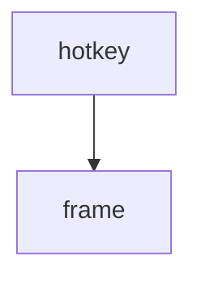

==> out/cm.md <==
# Flint

Generated by Kiln from commit 9f8e7d6c5b4a (2026-10-12).

| Type | Items | By status |
| --- | ---: | --- |
| Requirements | 4 | draft 1, approved 2, obsolete 1 |
| Decisions | 2 | accepted 1, superseded 1 |
| Tests | 1 | passing 1 |

Requirements: implemented by 1 of 3, verified by 1 of 3.

- [1 Requirements](#section:1 Requirements)
  - [1.1 REQ-001 Flint is a launcher](#REQ-001)
    - [1.1.1 REQ-002 Fast enough to be a reflex](#REQ-002)
    - [1.1.2 REQ-003 Themes follow Fenix](#REQ-003)
- [2 Decisions](#section:2 Decisions)
  - [2.1 ADR-002 TOML front matter](#ADR-002)
- [3 Tests](#section:3 Tests)
  - [3.1 TEST-001 Hotkey benchmark](#TEST-001)

## 1 Requirements

### 1.1 REQ-001 Flint is a launcher

| Property | Value |
| --- | --- |
| Status | **approved** |
| Type | Requirement |
| Jira | [FLINT-12](https://jira.example.com/browse/FLINT-12) |
| Source | [design/REQ-001-launcher.md](https://git.example.com/flint/-/blob/9f8e7d6c5b4a/design/REQ-001-launcher.md) |

Flint finds and opens things; see [ADR-002 TOML front matter](#ADR-002).

##### Scope

Windows and Linux.

#### 1.1.1 REQ-002 Fast enough to be a reflex

| Property | Value |
| --- | --- |
| Status | **approved** |
| Type | Requirement |
| Parent | [REQ-001 Flint is a launcher](#REQ-001) |
| Implemented by | [src/launcher.rs:2](https://git.example.com/flint/-/blob/c0de/src/launcher.rs#L2) |
| Verified by | [TEST-001 Hotkey benchmark](#TEST-001) |
| Tags | performance |
| Source | [design/REQ-002-fast.md](https://git.example.com/flint/-/blob/9f8e7d6c5b4a/design/REQ-002-fast.md) |

> [!NOTE]
> Measured on the reference laptop.

#### 1.1.2 REQ-003 Themes follow Fenix

| Property | Value |
| --- | --- |
| Status | **draft** |
| Type | Requirement |
| Parent | [REQ-001 Flint is a launcher](#REQ-001) |
| Source | [design/REQ-003-themes.md](https://git.example.com/flint/-/blob/9f8e7d6c5b4a/design/REQ-003-themes.md) |

| Theme | Source |
| --- | --- |
| dark | Fenix |

## 2 Decisions

### 2.1 ADR-002 TOML front matter

| Property | Value |
| --- | --- |
| Status | **accepted** |
| Type | Decision |
| Supersedes | [ADR-001 YAML front matter](https://git.example.com/flint/-/blob/9f8e7d6c5b4a/design/ADR-001-yaml.md) |
| Source | [design/ADR-002-toml.md](https://git.example.com/flint/-/blob/9f8e7d6c5b4a/design/ADR-002-toml.md) |

Comments survive edits.

## 3 Tests

### 3.1 TEST-001 Hotkey benchmark

| Property | Value |
| --- | --- |
| Status | **passing** |
| Type | Test |
| Verifies | [REQ-002 Fast enough to be a reflex](#REQ-002) |
| Source | [design/TEST-001-bench.md](https://git.example.com/flint/-/blob/9f8e7d6c5b4a/design/TEST-001-bench.md) |
