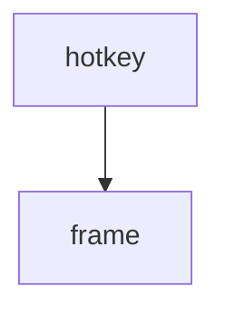

==> out/doc.md <==
# Flint — design document

## 1 Introduction

Generated by Kiln from commit 9f8e7d6c5b4a (2026-10-12).

| Type | Items | By status |
| --- | ---: | --- |
| Requirements | 4 | draft 1, approved 2, obsolete 1 |
| Decisions | 2 | accepted 1, superseded 1 |
| Tests | 1 | passing 1 |

Requirements: implemented by 1 of 3, verified by 1 of 3.

This document describes Flint.

- [1 Introduction](#1-introduction)
- [2 Requirements](#2-requirements)
  - [2.1 Performance](#21-performance)
    - [2.1.1 REQ-002 Fast enough to be a reflex](#211-req-002-fast-enough-to-be-a-reflex)
  - [2.2 Everything else](#22-everything-else)
    - [2.2.1 REQ-001 Flint is a launcher](#221-req-001-flint-is-a-launcher)
    - [2.2.2 REQ-003 Themes follow Fenix](#222-req-003-themes-follow-fenix)
- [3 Decisions](#3-decisions)
- [4 Appendix: traceability](#4-appendix-traceability)

## 2 Requirements

### 2.1 Performance

#### 2.1.1 REQ-002 Fast enough to be a reflex

| Status | **approved** |
| --- | --- |
| Parent | [REQ-001](#221-req-001-flint-is-a-launcher) |
| Implemented by | [src/launcher.rs:2](https://git.example.com/flint/-/blob/c0de/src/launcher.rs#L2) |
| Verified by | [TEST-001](https://git.example.com/flint/-/blob/9f8e7d6c5b4a/design/TEST-001-bench.md) |
| Tags | performance |

> [!NOTE]
> Measured on the reference laptop.

### 2.2 Everything else

#### 2.2.1 REQ-001 Flint is a launcher

| Status | **approved** |
| --- | --- |
| Jira | [FLINT-12](https://jira.example.com/browse/FLINT-12) |

Flint finds and opens things; see [ADR-002 TOML front matter](#3-decisions).

###### Scope

Windows and Linux.

#### 2.2.2 REQ-003 Themes follow Fenix

| Status | **draft** |
| --- | --- |
| Parent | [REQ-001](#221-req-001-flint-is-a-launcher) |

| Theme | Source |
| --- | --- |
| dark | Fenix |

## 3 Decisions

| ID | Title | Status | Links |
| --- | --- | --- | --- |
| ADR-001 | YAML front matter | **superseded** |  |
| ADR-002 | TOML front matter | **accepted** | supersedes [ADR-001](#3-decisions) |

## 4 Appendix: traceability

3 requirements: implemented by 1 of 3, verified by 1 of 3.

| Requirement | Title | Status | Implemented by | Verified by |
| --- | --- | --- | --- | --- |
| [REQ-001](#221-req-001-flint-is-a-launcher) | Flint is a launcher | **approved** | **gap** | **gap** |
| [REQ-002](#211-req-002-fast-enough-to-be-a-reflex) | Fast enough to be a reflex | **approved** | [src/launcher.rs:2](https://git.example.com/flint/-/blob/c0de/src/launcher.rs#L2) | [TEST-001](https://git.example.com/flint/-/blob/9f8e7d6c5b4a/design/TEST-001-bench.md) |
| [REQ-003](#222-req-003-themes-follow-fenix) | Themes follow Fenix | **draft** | **gap** | **gap** |
