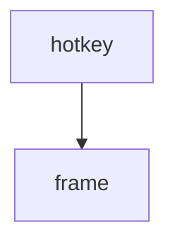

==> out/plain.md <==
# Flint

Generated by Kiln from commit 9f8e7d6c5b4a (2026-10-12).

| Type | Items | By status |
| --- | ---: | --- |
| Requirements | 4 | draft 1, approved 2, obsolete 1 |
| Decisions | 2 | accepted 1, superseded 1 |
| Tests | 1 | passing 1 |

Requirements: implemented by 1 of 3, verified by 1 of 3.

- [1 Requirements](#1-requirements)
  - [1.1 REQ-001 Flint is a launcher](#11-req-001-flint-is-a-launcher)
  - [1.2 REQ-002 Fast enough to be a reflex](#12-req-002-fast-enough-to-be-a-reflex)
  - [1.3 REQ-003 Themes follow Fenix](#13-req-003-themes-follow-fenix)
- [2 Decisions](#2-decisions)
  - [2.1 ADR-002 TOML front matter](#21-adr-002-toml-front-matter)
- [3 Tests](#3-tests)
  - [3.1 TEST-001 Hotkey benchmark](#31-test-001-hotkey-benchmark)
- [A Traceability](#a-traceability)
- [B Roadmap](#b-roadmap)
- [C Risks](#c-risks)
- [D Findings](#d-findings)

## 1 Requirements

### 1.1 REQ-001 Flint is a launcher

| Status | **approved** |
| --- | --- |
| Jira | [FLINT-12](https://jira.example.com/browse/FLINT-12) |

Flint finds and opens things; see [ADR-002 TOML front matter](#21-adr-002-toml-front-matter).

##### Scope

Windows and Linux.

### 1.2 REQ-002 Fast enough to be a reflex

| Status | **approved** |
| --- | --- |
| Parent | [REQ-001](#11-req-001-flint-is-a-launcher) |
| Implemented by | [src/launcher.rs:2](https://git.example.com/flint/-/blob/c0de/src/launcher.rs#L2) |
| Verified by | [TEST-001](#31-test-001-hotkey-benchmark) |
| Tags | performance |

> [!NOTE]
> Measured on the reference laptop.

### 1.3 REQ-003 Themes follow Fenix

| Status | **draft** |
| --- | --- |
| Parent | [REQ-001](#11-req-001-flint-is-a-launcher) |

| Theme | Source |
| --- | --- |
| dark | Fenix |

## 2 Decisions

### 2.1 ADR-002 TOML front matter

| Status | **accepted** |
| --- | --- |
| Supersedes | [ADR-001](https://git.example.com/flint/-/blob/9f8e7d6c5b4a/design/ADR-001-yaml.md) |

Comments survive edits.

## 3 Tests

### 3.1 TEST-001 Hotkey benchmark

| Status | **passing** |
| --- | --- |
| Verifies | [REQ-002](#12-req-002-fast-enough-to-be-a-reflex) |

## A Traceability

3 requirements: implemented by 1 of 3, verified by 1 of 3.

| Requirement | Title | Status | Implemented by | Verified by |
| --- | --- | --- | --- | --- |
| [REQ-001](#11-req-001-flint-is-a-launcher) | Flint is a launcher | **approved** | **gap** | **gap** |
| [REQ-002](#12-req-002-fast-enough-to-be-a-reflex) | Fast enough to be a reflex | **approved** | [src/launcher.rs:2](https://git.example.com/flint/-/blob/c0de/src/launcher.rs#L2) | [TEST-001](#31-test-001-hotkey-benchmark) |
| [REQ-003](#13-req-003-themes-follow-fenix) | Themes follow Fenix | **draft** | **gap** | **gap** |

## B Roadmap

No milestones.

## C Risks

No open risks.

## D Findings

No findings.
