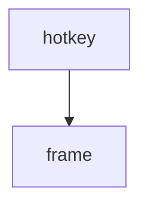

==> out/tree/decisions/ADR-002.md <==
# ADR-002 TOML front matter

| Property | Value |
| --- | --- |
| Status | **accepted** |
| Type | Decision |
| Supersedes | [ADR-001 YAML front matter](../../doc.md#3-decisions) |
| Source | [design/ADR-002-toml.md](https://git.example.com/flint/-/blob/9f8e7d6c5b4a/design/ADR-002-toml.md) |

Comments survive edits.
==> out/tree/decisions/index.md <==
# 2 Decisions

- [ADR-002 TOML front matter](ADR-002.md)
==> out/tree/findings/index.md <==
# B Findings

No findings.
==> out/tree/index.md <==
# Flint

Generated by Kiln from commit 9f8e7d6c5b4a (2026-10-12).

| Type | Items | By status |
| --- | ---: | --- |
| Requirements | 4 | draft 1, approved 2, obsolete 1 |
| Decisions | 2 | accepted 1, superseded 1 |
| Tests | 1 | passing 1 |

Requirements: implemented by 1 of 3, verified by 1 of 3.

- [1 Requirements](requirements/index.md)
- [2 Decisions](decisions/index.md)
- [A Traceability](traceability/index.md)
- [B Findings](findings/index.md)
==> out/tree/requirements/REQ-001.md <==
# REQ-001 Flint is a launcher

| Property | Value |
| --- | --- |
| Status | **approved** |
| Type | Requirement |
| Jira | [FLINT-12](https://jira.example.com/browse/FLINT-12) |
| Source | [design/REQ-001-launcher.md](https://git.example.com/flint/-/blob/9f8e7d6c5b4a/design/REQ-001-launcher.md) |

Flint finds and opens things; see [ADR-002 TOML front matter](../decisions/ADR-002.md).

### Scope

Windows and Linux.

- [REQ-002 Fast enough to be a reflex](REQ-002.md)
- [REQ-003 Themes follow Fenix](REQ-003.md)
==> out/tree/requirements/REQ-002.md <==
# REQ-002 Fast enough to be a reflex

| Property | Value |
| --- | --- |
| Status | **approved** |
| Type | Requirement |
| Parent | [REQ-001 Flint is a launcher](REQ-001.md) |
| Implemented by | [src/launcher.rs:2](https://git.example.com/flint/-/blob/c0de/src/launcher.rs#L2) |
| Verified by | [TEST-001 Hotkey benchmark](https://git.example.com/flint/-/blob/9f8e7d6c5b4a/design/TEST-001-bench.md) |
| Tags | performance |
| Source | [design/REQ-002-fast.md](https://git.example.com/flint/-/blob/9f8e7d6c5b4a/design/REQ-002-fast.md) |

> [!NOTE]
> Measured on the reference laptop.

==> out/tree/requirements/REQ-003.md <==
# REQ-003 Themes follow Fenix

| Property | Value |
| --- | --- |
| Status | **draft** |
| Type | Requirement |
| Parent | [REQ-001 Flint is a launcher](REQ-001.md) |
| Source | [design/REQ-003-themes.md](https://git.example.com/flint/-/blob/9f8e7d6c5b4a/design/REQ-003-themes.md) |

| Theme | Source |
| --- | --- |
| dark | Fenix |
==> out/tree/requirements/index.md <==
# 1 Requirements

- [REQ-001 Flint is a launcher](REQ-001.md)
==> out/tree/traceability/index.md <==
# A Traceability

3 requirements: implemented by 1 of 3, verified by 1 of 3.

| Requirement | Title | Status | Implemented by | Verified by |
| --- | --- | --- | --- | --- |
| [REQ-001](../requirements/REQ-001.md) | Flint is a launcher | **approved** | **gap** | **gap** |
| [REQ-002](../requirements/REQ-002.md) | Fast enough to be a reflex | **approved** | [src/launcher.rs:2](https://git.example.com/flint/-/blob/c0de/src/launcher.rs#L2) | [TEST-001](https://git.example.com/flint/-/blob/9f8e7d6c5b4a/design/TEST-001-bench.md) |
| [REQ-003](../requirements/REQ-003.md) | Themes follow Fenix | **draft** | **gap** | **gap** |
