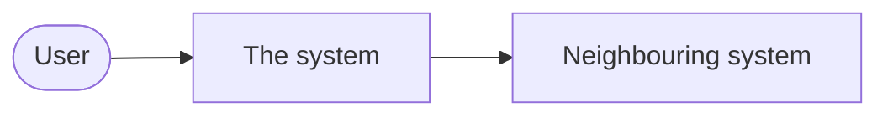
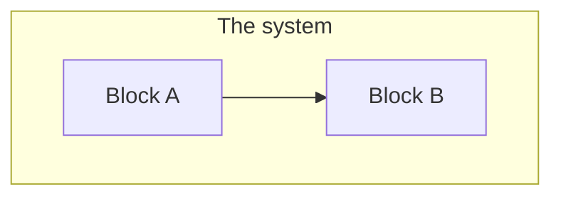
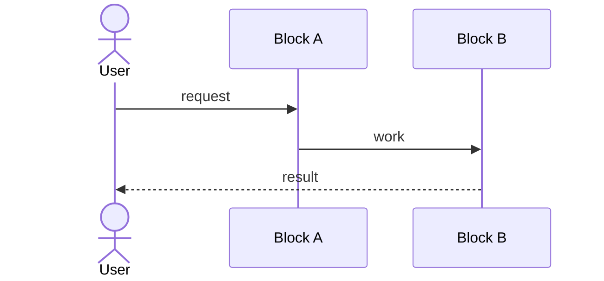

<!--
The arc42 template (https://arc42.org) as a Kiln export template, added
by `kiln preset add arc42`. The structure follows arc42; the wording
here is Kiln's. Edit it freely: it is this project's file now.

Comments like this one are notes for whoever edits the template: they
don't appear in the export. Everything else does, so replace the
placeholder sentences with this system's own text, and delete the
sections you don't need.

The sections that list items need these types in kiln.toml:
quality-goal, constraint, block, decision, quality-scenario, risk and
term, and an [[export]] whose `template` is this file. The wiki's
"Presets" page has that configuration, the links worth adding between
them, and the options. `kiln check` validates this file once an export
uses it.
-->

<!-- kiln:summary -->

# Introduction and Goals

<!-- What the system is for, and the forces that shape its architecture. -->

Describe the system in a few sentences: what it does, for whom, and why
it is being built.

## Requirements Overview

<!--
The essential functional requirements, briefly, or a link to where they
are specified. If they are Kiln requirements, a `kiln:items` directive
with type="requirement" and style="row" lists them here.
-->

Summarise the main use cases or features, or point to the requirements
document.

## Quality Goals

<!-- The three to five quality goals that matter most, in order of priority. -->

<!-- kiln:items type="quality-goal" style="row" -->

## Stakeholders

<!-- Who has to know or agree with the architecture, and what they expect from it. -->

| Role | Contact | Expectations |
|---|---|---|
| | | |

# Architecture Constraints

<!-- Anything that limits the design: technical, organisational, political, conventions. -->

<!-- kiln:items type="constraint" style="row" -->

# Context and Scope

<!-- The system as a black box: its neighbours, and what crosses the boundary. -->

## Business Context

Who and what the system talks to, and what is exchanged, in the domain's
terms.

## Technical Context

The channels and protocols on the boundary, and how the business
exchanges map onto them.

# Solution Strategy

<!--
The fundamental decisions and approaches, each with the goal or
constraint that drove it: technology, top-level decomposition, how the
key quality goals are reached, organisational choices.
-->

Summarise the approach in a few points, linking the decisions in section
9 and the quality goals in section 1.

# Building Block View

<!--
The static decomposition: level 1 is the system's main blocks, level 2
what is inside each of them, and so on. Each block is an item with its
parent block; open with an overview diagram.
-->

<!-- kiln:items type="block" nest="parent" -->

# Runtime View

<!-- The few scenarios that show how the blocks work together: important use cases, start-up, error handling. -->

## Scenario: a typical request

# Deployment View

<!-- The infrastructure the system runs on, and which block runs where. -->

Describe the environments (development, test, production) and map the
building blocks onto them.

# Crosscutting Concepts

<!--
Rules and solutions that apply across blocks: the domain model,
security, error handling, logging, configuration, testing. One
subsection per concept that matters for this system.
-->

## Domain Model

## Error Handling

# Architecture Decisions

<!-- The important, expensive or risky decisions, each with its context, alternatives and consequences. -->

<!-- kiln:items type="decision" -->

# Quality Requirements

<!--
The quality goals of section 1 made concrete: each scenario has its goal
as parent and says how the response is measured.
-->

<!-- kiln:items type="quality-scenario" -->

# Risks and Technical Debt

<!-- Known risks and technical debt, by priority, and what is done about them. -->

<!-- kiln:report risks -->

# Glossary

<!-- The domain and technical terms the readers need, each with its definition. -->

<!-- kiln:items type="term" style="compact" -->
