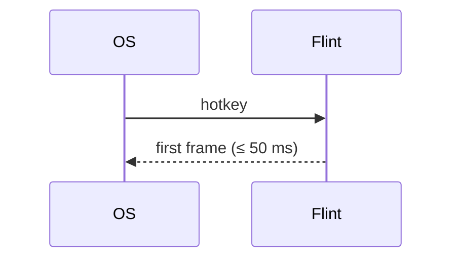

# Kiln file format, version 1

The contract between people, Kiln and every tool that reads a Kiln
project. `kiln-model` and `kiln-parse` implement exactly this; change both
together. Anything this document leaves unspecified is an error to rely on.

## The project

A Kiln project is a directory with a `kiln.toml` at its root, normally a
repository root. Items are the Markdown files under the configured
`paths`. Everything is UTF-8; line endings are normalised to `\n` on read
and never changed on write (Kiln writes back the file's own ending).

## `kiln.toml`

```toml
format = 1                       # required; this document's version
name = "Flint"                   # shown in reports and in Confluence
paths = ["design"]               # where items live (relative, inside the project)

# Where source code is scanned for code references (see below).
[code]
paths = ["crates", "examples"]
patterns = ["(?:implements|verifies|satisfies):\\s*(?P<ids>[A-Z][A-Z0-9]*-\\d+(?:\\s*,\\s*[A-Z][A-Z0-9]*-\\d+)*)"]

# How a file in the repo is linked on the web; {commit}, {path}, {line}.
[repository]
web = "https://gitlab.example.com/team/flint/-/blob/{commit}/{path}#L{line}"

[types.requirement]
prefix = "REQ"
title = "Requirement"            # display name; plural adds "s" unless `plural` is set
statuses = ["draft", "proposed", "approved", "implemented", "verified", "obsolete"]
initial = "draft"
done = ["verified"]              # statuses that count as finished for progress
closed = ["obsolete"]            # statuses excluded from coverage and progress
parents = ["requirement"]        # types allowed as `parent`
template = "templates/requirement.md"   # optional; relative to the project

[types.design]
prefix = "DES"
statuses = ["draft", "accepted", "obsolete"]
parents = ["design"]

[types.decision]
prefix = "ADR"
statuses = ["proposed", "accepted", "rejected", "superseded"]
closed = ["rejected", "superseded"]

[types.milestone]
prefix = "MS"
statuses = ["planned", "active", "done", "dropped"]
done = ["done"]
closed = ["dropped"]

[types.task]
prefix = "TASK"
statuses = ["todo", "doing", "blocked", "done", "dropped"]
done = ["done"]
closed = ["dropped"]
parents = ["task"]

[types.test]
prefix = "TEST"
statuses = ["draft", "ready", "passing", "failing", "obsolete"]
closed = ["obsolete"]

[types.risk]
prefix = "RISK"
statuses = ["open", "mitigated", "accepted", "closed"]
closed = ["closed"]

# Link roles. Each is written on its `from` side only; `inverse` is how it
# reads from the other side and is never written in a file.
[links.implements]
from = ["design", "task", "code"]
to = ["requirement"]
inverse = "implemented by"

[links.verifies]
from = ["test", "code"]
to = ["requirement"]
inverse = "verified by"

[links.part-of]
from = ["task"]
to = ["milestone"]
inverse = "includes"

[links.supersedes]
from = ["decision"]
to = ["decision"]
inverse = "superseded by"

[links.mitigates]
from = ["requirement", "design", "task"]
to = ["risk"]
inverse = "mitigated by"

[links.depends-on]
from = ["task", "milestone"]
to = ["task", "milestone"]
inverse = "blocks"

# What counts toward coverage (see "The model Kiln computes").
[coverage]
roles = ["implements", "verifies"]

[render]
link_bare_ids = true             # REQ-014 in prose is a reference, not only [[REQ-014]]

# Where `jira` keys point. Read-only; the token never goes here.
[jira]
url = "https://jira.example.com"

# Severity overrides for check rules (see "Check rules").
[check]
K201 = "error"                   # an approved requirement nobody verifies fails CI
K106 = "off"

# Publishing: see CONFLUENCE.md.
[confluence]
# …
```

Rules:

- `format`, `name` and at least one `[types.*]` are required. `kiln init`
  writes the defaults above.
- A type name, a link role and a status are lowercase ASCII words with
  `-`. `code` is a reserved pseudo-type for code references; it can only
  appear in `from`.
- Prefixes are uppercase ASCII letters and digits, starting with a letter,
  unique across types.
- An unknown key is a finding (K003), not ignored silently: typos in
  configuration should be loud.
- `kiln.toml` never contains secrets (K004 if a key looks like
  `token`/`password`/`secret`).

## Items

An item is a `.md` file under `paths` whose first line is `+++`. Files
without front matter are ignored (a `README.md` in `design/` is fine).

~~~markdown
+++
id = "REQ-014"
type = "requirement"
title = "Flint appears within 50 ms of the hotkey"
status = "approved"
parent = "REQ-002"
tags = ["performance"]
jira = "FLINT-88"

[links]
mitigates = ["RISK-003"]
+++

Measured from receipt of the hotkey to the first presented frame, at the
95th percentile, on the reference laptop with ten providers registered.

## Rationale

Anything slower stops being a reflex; see [[ADR-004]].


~~~

### Front matter

TOML between a `+++` line and the next `+++` line. TOML rather than YAML
because Kiln edits front matter (status, links) and `toml_edit` keeps the
author's comments and layout; because it is the configuration language of
the rest of the suite; and because it has no implicit typing surprises.

| Key | Type | Required | Meaning |
|---|---|---|---|
| `id` | string | yes | `PREFIX-N`, N a positive integer without leading zeros. Authoritative: the file name is not. |
| `type` | string | yes | a `[types.*]` name; must match the ID's prefix |
| `title` | string | yes | one line, ≤ 200 characters |
| `status` | string | yes | one of the type's statuses |
| `parent` | string | no | an item ID of an allowed parent type |
| `tags` | array of strings | no | free-form, lowercase |
| `jira` | string or array | no | Jira issue keys |
| `owner` | string | no | a name or handle, informational only (no assignment semantics) |
| `due` | date | no | TOML local date; meaningful for milestones and tasks |
| `[links]` | table of role → array of IDs | no | outgoing links; roles must allow this item's type as `from` |
| `[extra]` | table | no | anything a project wants; Kiln preserves and shows it, never interprets it |

Any other top-level key is finding K104.

### File names and placement

`design/<anything>/<ID>-<slug>.md` by convention (`kiln new` writes
`design/<type plural>/REQ-014-flint-appears-within-50-ms.md`). Folders
carry no meaning; `parent` is the hierarchy. A file name that doesn't
start with its ID is warning K105, because people find files by name.

### Body

CommonMark plus GitHub tables, task lists and strikethrough
(`pulldown-cmark` with those options), and these extensions:

| Syntax | Means |
|---|---|
| `[[REQ-014]]` | a reference to an item, rendered as its ID and title, linked |
| `[[REQ-014\|custom text]]` | the same with custom text |
| a bare `REQ-014` in prose | a reference too, when `[render] link_bare_ids = true` (default `true`); never inside code |
| ` ```mermaid ` fenced block | a diagram, rendered with `fenix-diagram` |
| `> [!NOTE]`, `[!TIP]`, `[!WARNING]`, `[!CAUTION]`, `[!IMPORTANT]` | a callout (GitHub's syntax) |
| relative link or image (`../img/x.png`) | a file in the repo; must exist (K110) |

Raw HTML in a body is shown as text, never passed through.

References in the body are **mentions**, not links: they show up in
"mentioned by" but carry no role, count toward no coverage and are never
inverted into a role. Coverage needs a front-matter link or a code
reference, which are deliberate.

## IDs

- Allocated by `kiln new` as the highest existing number for that prefix
  plus one, across all items including obsolete ones (IDs are never
  reused).
- Two branches can allocate the same ID. `kiln check` reports the
  duplicate (K101) after the merge; `kiln renumber REQ-015 --to REQ-016`
  (or LSP rename) moves one and rewrites every reference: front matter,
  bodies and code references. The tradeoff is deliberate: readable
  sequential IDs that people say aloud in meetings, over collision-free
  IDs nobody can remember.
- Deleting an item's file is allowed; references to it then fail K102.
  Prefer status `obsolete`, which keeps the history readable.

## Code references

Source files under `[code] paths` (respecting `.gitignore`) are scanned for
the configured `patterns`. Each pattern must have a named group `ids`
holding one or more IDs separated by commas; the word before the colon
must be a link role whose `from` includes `code`. A match makes the code
location (`path:line`) the source of that link:

```rust
// implements: REQ-014
fn show_window(&mut self) { … }

#[test]
// verifies: REQ-014, REQ-015
fn hotkey_to_first_frame_is_under_budget() { … }
```

```tcl
# verifies: REQ-031
proc test_tm_rate {} { … }
```

Only comment text is meaningful to people, but Kiln matches whole lines
and does not parse languages: a match inside a string literal counts. That
keeps the scanner language-agnostic and fast; the pattern's role word and
colon make accidental matches rare. Binary files and files over 2 MiB are
skipped.

## The model Kiln computes

- **Inverse links** for every role, from items and code locations.
- **Tree**: `parent` edges; a cycle is K103.
- **Coverage** of an item, for each role in `[coverage] roles` (default
  `["implements", "verifies"]`): covered if at least one non-closed source
  links to it with that role. Children count: a requirement is covered
  when it is covered itself or all its non-closed children are.
- **Progress** of a milestone: done ÷ (all − closed) over items that are
  `part-of` it, recursively through `depends-on` milestones.
- **Impact** of an item: every item and code location that reaches it by
  any link or parent edge, with the path, breadth first.

## Check rules

Each rule has a code, a default severity and a span (file, line, column).
Severities: `error` (exit 1), `warning`, `off`, overridable in `[check]`.

| Code | Default | Rule |
|---|---|---|
| K001 | error | `kiln.toml` can't be parsed |
| K002 | error | `kiln.toml` is invalid (unknown type in `parents`/`from`/`to`, duplicate prefix, bad regex) |
| K003 | error | unknown key in `kiln.toml` |
| K004 | error | something that looks like a secret in `kiln.toml` |
| K100 | error | front matter can't be parsed |
| K101 | error | duplicate ID |
| K102 | error | reference to an ID that doesn't exist (front matter, body, code) |
| K103 | error | `parent` cycle |
| K104 | error | unknown front-matter key, missing required key, wrong value type |
| K105 | warning | file name doesn't start with the ID |
| K106 | warning | ID prefix doesn't match `type` |
| K107 | error | status not allowed for the type |
| K108 | error | link role not allowed from this type or to the target's type; `parent` of a disallowed type |
| K109 | warning | a link is written on its inverse side (e.g. `verified-by` in a requirement) |
| K110 | error | relative link or image to a file that doesn't exist |
| K111 | error | a Mermaid block fails to parse (the diagram's own line and message) |
| K201 | warning | a non-draft requirement with no `verifies` coverage |
| K202 | warning | a non-draft requirement with no `implements` coverage |
| K203 | warning | a non-closed item links to a closed one (e.g. implements an obsolete requirement) |
| K204 | warning | a decision with status `superseded` that nothing `supersedes` |
| K205 | warning | status `verified` but no passing `verifies` source (a test item with status `passing`, or a code reference) |
| K206 | warning | a milestone past its `due` date and not done |
| K207 | off | a work item `done` whose linked Jira ticket isn't resolved, or the reverse (needs the Jira mirror, K8; INTEGRATION.md) |

Output formats: `text` (`path:line:col: K102 error: REQ-099 doesn't
exist`), `json` (an array of findings with all fields), `gitlab` (GitLab
Code Quality report JSON, so findings show on merge requests), `github`
(`::error file=…,line=…::` workflow commands).

## Edits Kiln makes

`kiln set`, `link`, `unlink`, `renumber`, `new`, LSP code actions and the
Flint provider are the only writers. They:

- change only the front-matter keys they are about, through `toml_edit`,
  so comments, ordering and spacing survive;
- write atomically (`fenix_storage::write`);
- refuse when the file changed on disk since it was read (mtime and
  length), so an editor's unsaved buffer and Kiln never silently fight;
- never touch the body, except `renumber`, which rewrites the ID text and
  nothing else.

## Versioning

`format` changes only for incompatible changes. A newer Kiln reading an
older `format` either supports it or says which `kiln migrate` to run; it
never guesses. Adding optional keys, types, roles or rules is compatible.
