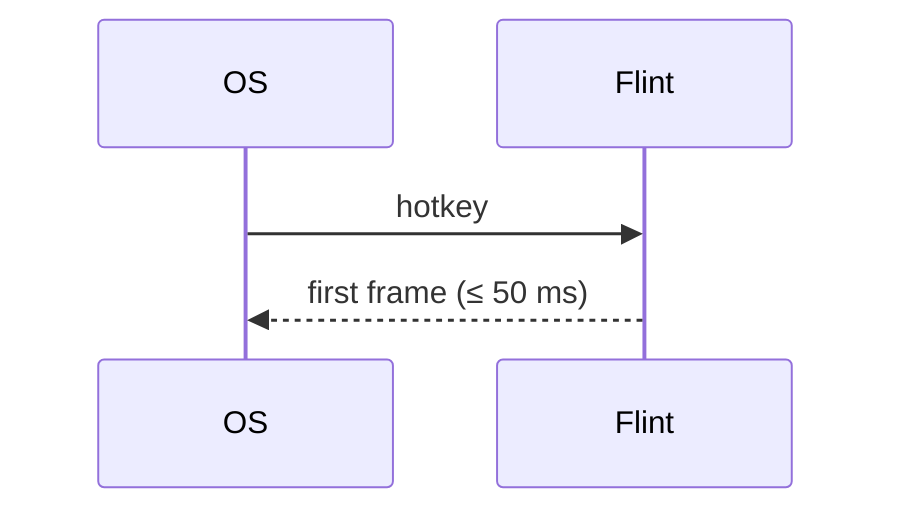

# Kiln file format, version 1

The contract between people, Kiln and every tool that reads a Kiln
project. `kiln-model` and `kiln-parse` implement exactly this; change both
together. Anything this document leaves unspecified is an error to rely on.

## The project

A Kiln project is a directory with a `kiln.toml` at its root, normally a
repository root. Items are the Markdown files under the configured
`paths`. Everything is UTF-8; line endings are normalised to `\n` on read
and never changed on write (Kiln writes back the file's own ending).

## `kiln.toml`

```toml
format = 1                       # required; this document's version
name = "Flint"                   # shown in reports and in Confluence
paths = ["design"]               # where items live (relative, inside the project)

# Where source code is scanned for code references (see below).
[code]
paths = ["crates", "examples"]
exclude = ["crates/*/tests/fixtures"]   # optional; gitignore-style globs
patterns = ["(?:implements|verifies):\\s*(?P<ids>[A-Z][A-Z0-9]*-\\d+(?:\\s*,\\s*[A-Z][A-Z0-9]*-\\d+)*)"]

# How a file in the repo is linked on the web; {commit}, {path}, {line}.
[repository]
web = "https://gitlab.example.com/team/flint/-/blob/{commit}/{path}#L{line}"

[types.requirement]
prefix = "REQ"
title = "Requirement"            # display name; default: the name, capitalised
plural = "Requirements"          # default: `title` plus "s"
statuses = ["draft", "proposed", "approved", "implemented", "verified", "obsolete"]
initial = "draft"                # what `kiln new` writes; default: the first status
done = ["verified"]              # statuses that count as finished for progress
closed = ["obsolete"]            # statuses excluded from coverage and progress
parents = ["requirement"]        # types allowed as `parent`
template = "templates/requirement.md"   # optional: the body of a new item (`kiln new`)

[types.design]
prefix = "DES"
statuses = ["draft", "accepted", "obsolete"]
parents = ["design"]

[types.decision]
prefix = "ADR"
statuses = ["proposed", "accepted", "rejected", "superseded"]
closed = ["rejected", "superseded"]

[types.milestone]
prefix = "MS"
statuses = ["planned", "active", "done", "dropped"]
done = ["done"]
closed = ["dropped"]

[types.task]
prefix = "TASK"
statuses = ["todo", "doing", "blocked", "done", "dropped"]
done = ["done"]
closed = ["dropped"]
parents = ["task"]

[types.test]
prefix = "TEST"
statuses = ["draft", "ready", "passing", "failing", "obsolete"]
closed = ["obsolete"]

[types.risk]
prefix = "RISK"
statuses = ["open", "mitigated", "accepted", "closed"]
closed = ["closed"]

# Link roles. Each is written on its `from` side only; `inverse` is how it
# reads from the other side and is never written in a file.
[links.implements]
from = ["design", "task", "code"]
to = ["requirement"]
inverse = "implemented by"

[links.verifies]
from = ["test", "code"]
to = ["requirement"]
inverse = "verified by"

[links.part-of]
from = ["task"]
to = ["milestone"]
inverse = "includes"

[links.supersedes]
from = ["decision"]
to = ["decision"]
inverse = "superseded by"

[links.mitigates]
from = ["requirement", "design", "task"]
to = ["risk"]
inverse = "mitigated by"

[links.depends-on]
from = ["task", "milestone"]
to = ["task", "milestone"]
inverse = "blocks"

# What counts toward coverage (see "The model Kiln computes").
[coverage]
roles = ["implements", "verifies"]

# Requirement levels, highest first, and the role that traces each level
# to the one above (see "Requirement levels"). Without this table the one
# level is `requirement`.
# [requirements]
# levels = ["stakeholder", "system", "software"]
# trace = "refines"              # default

[render]
link_bare_ids = true             # REQ-014 in prose is a reference, not only [[REQ-014]]

# Where `jira` keys point; the token never goes here. With `project`,
# `kiln jira sync` keeps a sub-task per task in step (INTEGRATION.md).
[jira]
url = "https://jira.example.com"
project = "FLINT"                # optional: the Jira project Kiln's tickets go in
parent = "FLINT-100"             # written by the first sync: the project issue
# parent_type = "Task"           # the project issue's type when created
# subtask_type = "Sub-task"      # default: the project's sub-task type
# types = ["task"]               # the Kiln types synced

[jira.status]                    # optional: Kiln status → Jira status name
blocked = "Blocked"              # unmapped statuses go by status category

# Severity overrides for check rules (see "Check rules").
[check]
K201 = "error"                   # an approved requirement nobody verifies fails CI
K106 = "off"

# Exports: see EXPORT.md and CONFLUENCE.md.
[confluence]
# …

[[export]]
name = "spec"
format = "confluence"
# …
```

Rules:

- `format`, `name` and at least one `[types.*]` are required. `paths`
  defaults to `["design"]`; a listed folder that doesn't exist is K002.
  `kiln init` writes the defaults above (without `[code]`, which only the
  project knows).
- A newer `format` than Kiln reads is refused, naming the fix ("update
  Kiln"); nothing else is read from that file.
- A type name, a link role and a status are lowercase ASCII words with
  `-`. `code` is a reserved pseudo-type for code references; it can only
  appear in `from`.
- Prefixes are uppercase ASCII letters and digits, starting with a letter,
  unique across types.
- Paths (`paths`, `code.paths`, `template`) are relative and stay inside
  the project: an absolute path or any `..` is K002.
- `[requirements] levels` names declared types, each once; with more
  than one level, `trace` (default `refines`) must be a declared role
  whose `from` and `to` let each level point at the one above. Otherwise
  K002, naming the level or the pair; the levels that are types still
  apply.
- `[check]` keys are rule codes; an unknown code or a severity other than
  `error`, `warning`, `off` is K002. K001 can't be turned off: nothing
  else can be read without the file.
- An invalid type, role or pattern is reported and left out; the rest of
  the file still applies, so one mistake doesn't hide the others.
- `[confluence]` and `[[export]]` are described in EXPORT.md and
  CONFLUENCE.md. A bad value in `[confluence]` is K002; an `[[export]]`
  that can't work is K005 and is left out, so the other targets still
  export.
- An unknown key is a finding (K003), not ignored silently: typos in
  configuration should be loud.
- `kiln.toml` never contains secrets (K004 if a key looks like
  `token`/`password`/`secret`).

## Items

An item is a `.md` file under `paths` whose first line is `+++`. Files
without front matter are ignored (a `README.md` in `design/` is fine).

~~~markdown
+++
id = "REQ-014"
type = "requirement"
title = "Flint appears within 50 ms of the hotkey"
status = "approved"
parent = "REQ-002"
tags = ["performance"]
jira = "FLINT-88"

[links]
mitigates = ["RISK-003"]
+++

Measured from receipt of the hotkey to the first presented frame, at the
95th percentile, on the reference laptop with ten providers registered.

## Rationale

Anything slower stops being a reflex; see [[ADR-004]].


~~~

### Front matter

TOML between a `+++` line and the next `+++` line. TOML rather than YAML
because Kiln edits front matter (status, links) and `toml_edit` keeps the
author's comments and layout; because it is the configuration language of
the rest of the suite; and because it has no implicit typing surprises.

| Key | Type | Required | Meaning |
|---|---|---|---|
| `id` | string | yes | `PREFIX-N`, N a positive integer written with at least three digits, zero-padded (`REQ-007`, `REQ-014`, `REQ-1000`). Exactly one spelling per number: `REQ-7` and `REQ-0014` are not IDs (see "IDs"). Authoritative: the file name is not. |
| `type` | string | yes | a `[types.*]` name (else K104); must match the ID's prefix (else K106) |
| `title` | string | yes | one line, ≤ 200 characters |
| `status` | string | yes | one of the type's statuses |
| `parent` | string | no | an item ID of an allowed parent type |
| `tags` | array of strings | no | free-form, lowercase |
| `jira` | string or array | no | Jira issue keys |
| `owner` | string | no | a name or handle, informational only (no assignment semantics) |
| `due` | date | no | TOML local date; meaningful for milestones and tasks |
| `derived` | boolean | no | `true` on a requirement below the top level that deliberately traces to nothing above it; the body says why (see "Requirement levels") |
| `[links]` | table of role → array of IDs | no | outgoing links; roles must allow this item's type as `from` |
| `[extra]` | table | no | anything a project wants; Kiln preserves and shows it, never interprets it |

Any other top-level key is finding K104.

### File names and placement

`design/<anything>/<ID>-<slug>.md` by convention (`kiln new` writes
`design/<type plural>/REQ-014-flint-appears-within-50-ms.md`). Folders
carry no meaning; `parent` is the hierarchy. A file name that doesn't
start with its ID is warning K105, because people find files by name.

### Body

CommonMark plus GitHub tables, task lists and strikethrough
(`pulldown-cmark` with those options), and these extensions:

| Syntax | Means |
|---|---|
| `[[REQ-014]]` | a reference to an item, rendered as its ID and title, linked |
| `[[REQ-014\|custom text]]` | the same with custom text |
| a bare `REQ-014` in prose | a reference too, when `[render] link_bare_ids = true` (default `true`): only with a prefix declared in `kiln.toml` (so `UTF-8` or a Jira key is not one), only as a whole word (not inside `X-REQ-014` or `REQ-014-title.md`), never inside code spans, code blocks or HTML |
| ` ```mermaid ` fenced block | a diagram, rendered with `fenix-diagram` |
| `> [!NOTE]`, `[!TIP]`, `[!WARNING]`, `[!CAUTION]`, `[!IMPORTANT]` | a callout (GitHub's syntax) |
| relative link or image (`../img/x.png`) | a file in the repo, relative to the item's folder (`/x` is from the project root); must exist and stay inside the project (K110). URLs, `mailto:` and `#anchors` are not checked |

Raw HTML in a body is shown as text, never passed through.

References in the body are **mentions**, not links: they show up in
"mentioned by" but carry no role, count toward no coverage and are never
inverted into a role. Coverage needs a front-matter link or a code
reference, which are deliberate.

## IDs

- Written with at least three digits, zero-padded, and exactly one
  spelling per number: `REQ-007`, `REQ-014`, `REQ-999`, `REQ-1000`. An ID
  found by `grep` is the ID in the file, and IDs sort the same as text and
  as numbers up to 999. Another spelling (`REQ-7`, `REQ-0014`) in front
  matter is K104 and in a reference K102, each naming the right one.
- Allocated by `kiln new` as the highest existing number for that prefix
  plus one, across all items including obsolete ones (IDs are never
  reused).
- Two branches can allocate the same ID. `kiln check` reports the
  duplicate (K101) after the merge; `kiln renumber REQ-015 --to REQ-016`
  (or LSP rename) moves one and rewrites every reference: front matter,
  bodies and code references. The tradeoff is deliberate: readable
  sequential IDs that people say aloud in meetings, over collision-free
  IDs nobody can remember.
- Deleting an item's file is allowed; references to it then fail K102.
  Prefer status `obsolete`, which keeps the history readable.

## Code references

Source files under `[code] paths` (respecting `.gitignore`, minus the
`exclude` globs) are scanned for the configured `patterns`. Each pattern
must have a named group `ids` holding one or more IDs separated by
commas; the word just before the colon that precedes `ids` is the link
role, which must be one whose `from` includes `code` (else K108). Without
`patterns`, the default matches `<role>: ID[, ID…]` for every role whose
`from` includes `code`. A match makes the code location (`path:line`) the
source of that link:

```rust
// implements: REQ-014
fn show_window(&mut self) { … }

#[test]
// verifies: REQ-014, REQ-015
fn hotkey_to_first_frame_is_under_budget() { … }
```

```tcl
# verifies: REQ-031
proc test_tm_rate {} { … }
```

Only comment text is meaningful to people, but Kiln matches whole lines
and does not parse languages: a match inside a string literal counts. That
keeps the scanner language-agnostic and fast; the pattern's role word and
colon make accidental matches rare. Binary files (a NUL byte in the first
8 KiB) and files over 2 MiB are skipped; item files under `paths` are never
scanned as code. A file that isn't UTF-8 is scanned with invalid bytes
replaced, and `kiln renumber` leaves its references alone. `exclude` is
for files holding code references on purpose, such as test fixtures.

## The model Kiln computes

- **Inverse links** for every role, from items and code locations.
- **Tree**: `parent` edges; a cycle is K103.
- **Coverage** of an item, for each role in `[coverage] roles` (default
  `["implements", "verifies"]`): covered if at least one non-closed source
  links to it with that role. Children count: a requirement is covered
  when it is covered itself or all its non-closed children are.
- **Progress** of a milestone: done ÷ (all − closed) over items that are
  `part-of` it or any milestone it `depends-on`, transitively.
- **Impact** of an item: every item and code location that reaches it by
  any link or parent edge (a child reaches its parent), with the path,
  breadth first.

## Requirement levels

Requirements are often written at several levels: what stakeholders
need, what the system must do, what each piece of software must do
(ISO/IEC/IEEE 29148, the V-model), or DO-178C's high- and low-level
requirements. Each level is a type of its own, with its own prefix and
statuses; `[requirements] levels` lists them, highest first, and names
the role that traces a level to the one above:

```toml
[types.stakeholder]
prefix = "STK"
title = "Stakeholder requirement"
statuses = ["draft", "approved", "obsolete"]
closed = ["obsolete"]
parents = ["stakeholder"]

[types.system]
prefix = "SYS"
title = "System requirement"
statuses = ["draft", "approved", "implemented", "verified", "obsolete"]
closed = ["obsolete"]
parents = ["system"]

# … [types.software] likewise, with prefix "SW"

[links.refines]
from = ["system", "software"]
to = ["stakeholder", "system"]
inverse = "refined by"

[requirements]
levels = ["stakeholder", "system", "software"]
```

- **`parent` decomposes within a level; the trace role crosses levels.**
  A system requirement `refines` the stakeholder requirement it answers,
  written once on the lower side like every link. A requirement with no
  trace link of its own traces through its parent: a decomposed system
  requirement links upward once, at the top of its subtree.
- **Derived requirements say so.** A requirement below the top level that
  answers no requirement above it (a watchdog the design calls for, a
  safety mechanism) has `derived = true` and explains why in its body.
  One that traces nowhere without saying so is K208, so the difference
  between "on purpose" and "forgotten" is visible and reviewed.
- **Each level is covered by the roles that can point at it.** `verifies`
  and `implements` apply to every level their `to` lists (K201, K202):
  in a V-model, tests verify each level, and code implements only the
  lowest. Above the lowest level, a requirement is also covered when the
  level below refines it (K210), counted like any coverage: directly, or
  through all its open children. A link that skips a level or points
  sideways is K209; it still counts where it points, so one wrong link is
  one finding.
- Without `[requirements]`, the one level is the type named
  `requirement`, so K201 and K202 behave as they always have; a project
  that names its requirements differently lists that type alone.

`kiln trace --levels` and the `levels` report (EXPORT.md, "Reports")
follow the levels down from the top: each chain, then the derived
requirements, then those that trace to nothing.

## Baselines

A **baseline** is a git revision (a tag such as `v1.0`, a branch, a
commit). `kiln diff REV[..REV]` and `kiln export --since REV` compare the
project there with the project now (the working tree, uncommitted edits
included) or at a second revision, item by item:

- The project at a revision is its `kiln.toml` and Markdown files as git
  has them there, read without checking anything out. Code isn't read:
  code references aren't compared (they move with every refactoring; the
  comparison is for readers of the design). A revision from before the
  project had a `kiln.toml` has no items, so everything reads as added.
- Items are matched by ID. A renumbered item is one removed and one
  added. A duplicated ID is compared by its first copy on each side.
- An item is **added** or **removed** when its ID exists on one side
  only, and **changed** when any of these differ: `status`, `title`,
  `type`, `parent`, `[links]` (each role and target added or removed),
  `tags` and `jira` (as sets), `owner`, `due`, `derived`, the body (ignoring leading
  and trailing blank lines), the file it lives in.
- Revisions are passed to git as revisions, never as options: one
  starting with `-` is refused.

## Check rules

Each rule has a code, a default severity and a span (file, line, column).
Severities: `error` (exit 1), `warning`, `off`, overridable in `[check]`.

| Code | Default | Rule |
|---|---|---|
| K001 | error | `kiln.toml` can't be parsed |
| K002 | error | `kiln.toml` is invalid (unknown type in `parents`/`from`/`to`, duplicate prefix, bad regex) |
| K003 | error | unknown key in `kiln.toml` |
| K004 | error | something that looks like a secret in `kiln.toml` |
| K005 | error | an `[[export]]` target is invalid: unknown format or layout, duplicate name, `page =` with a layout other than `document`, a file format without `path`, a Confluence target without the `[confluence]` keys it needs, a `link_to` naming no target |
| K100 | error | front matter can't be parsed |
| K101 | error | duplicate ID (on every copy, naming the others and the `kiln renumber` that fixes it) |
| K102 | error | reference to an ID that doesn't exist, or that isn't written as an ID (front matter, body, code) |
| K103 | error | `parent` cycle |
| K104 | error | unknown front-matter key, missing required key, wrong value type, a `type` not in `kiln.toml`, an `id` not spelt as an ID, a title over 200 characters or on several lines, a tag with uppercase letters |
| K105 | warning | file name doesn't start with the ID |
| K106 | warning | ID prefix doesn't match `type` |
| K107 | error | status not allowed for the type |
| K108 | error | link role not declared, not allowed from this type (or from code) or to the target's type; `parent` of a disallowed type |
| K109 | warning | a link is written on its inverse side (e.g. `verified-by` in a requirement) |
| K110 | error | relative link or image to a file that doesn't exist |
| K111 | error | a Mermaid block fails to parse (the diagram's own line and message) |
| K112 | error | an export template is invalid: unknown directive or attribute, unknown type, status or ID, a template file that doesn't exist; a Word target's `reference` document that doesn't exist or isn't a `.docx` |
| K201 | warning | a requirement (of any level, see "Requirement levels") past its type's `initial` status (non-draft, by default) and not closed, with no `verifies` coverage, when `verifies` can point at its type |
| K202 | warning | the same with no `implements` coverage |
| K203 | warning | a non-closed item links to a closed one (e.g. implements an obsolete requirement) |
| K204 | warning | a decision with status `superseded` that nothing `supersedes` |
| K205 | warning | status `verified` but no passing `verifies` source (a test item with status `passing`, or a code reference) |
| K206 | warning | a milestone past its `due` date (compared with today, UTC) and neither done nor closed |
| K207 | off | an item with `jira` keys whose type has `done` statuses (a task, a milestone…) is done while one of its tickets isn't resolved (in Jira's Done category), or every ticket is resolved while the item is neither done nor closed; read from the Jira mirror (INTEGRATION.md, "Jira") |
| K208 | warning | a requirement below the top level, past its `initial` status and not closed, that traces to no requirement above it (itself or through its parent) and isn't `derived`; also `derived` on a type that isn't a level below the top, and `derived` with a trace link |
| K209 | warning | a trace link that doesn't point at the level directly above (it skips a level, or points sideways or down) |
| K210 | warning | a requirement above the lowest level, past its `initial` status and not closed, that no requirement of the level below refines |

K207 reads the Jira mirror, so it needs `[jira] url` and a token
(`KILN_JIRA_TOKEN` or `kiln auth jira`); when Jira can't be read, `kiln
check` says "K207 not checked: …" on stderr and checks the rest, since
Kiln works without Jira. Tickets Jira doesn't know are left out. K111 parses each diagram with `fenix-diagram`, the renderer exports
draw with, so a diagram that passes draws. K112 checks each target's
template once, even when several targets share it.

Output formats: `text` (`path:line:col: K102 error: REQ-099 doesn't
exist`), `json` (an array of findings with all fields), `gitlab` (GitLab
Code Quality report JSON, so findings show on merge requests), `github`
(`::error file=…,line=…::` workflow commands). Findings are sorted by
file, line, column and rule.

## Edits Kiln makes

`kiln set`, `link`, `unlink`, `renumber`, `new` and the Flint provider
are the only writers. `kiln lsp` computes the same edits with the same
functions but writes nothing: it hands them to the editor as workspace
edits, which apply to the open buffer (and undo there). The writers:

- change only the front-matter keys they are about, through `toml_edit`,
  so comments, ordering and spacing survive;
- write atomically (`fenix_storage::write`), with the file's own line
  ending (judged by its first line) and byte-order mark;
- refuse when the file changed on disk since it was read (mtime and
  length), so an editor's unsaved buffer and Kiln never silently fight;
- never touch the body, except `renumber`, which rewrites the ID text of
  every reference Kiln counts (front matter, mentions, code references)
  and nothing else; text inside code spans isn't a reference and stays.
  When the ID is duplicated, references can't say which item they meant:
  only the chosen file's own ID and name change, and the references are
  listed for a person to check.

Formatting (`kiln lsp`, `textDocument/formatting`) is the one edit that
touches keys it isn't "about": it puts the top-level keys in the order of
the table in "Front matter" (`id`, `type`, `title`, `status`, `parent`,
`tags`, `jira`, `owner`, `due`, `derived`, then unknown keys, then `[links]` and
`[extra]`) and writes every string as `"…"`. Comments move with their
key; spacing, the body and everything else stay.

## Versioning

`format` changes only for incompatible changes. A newer Kiln reading an
older `format` either supports it or says which `kiln migrate` to run; it
never guesses. Adding optional keys, types, roles or rules is compatible.
