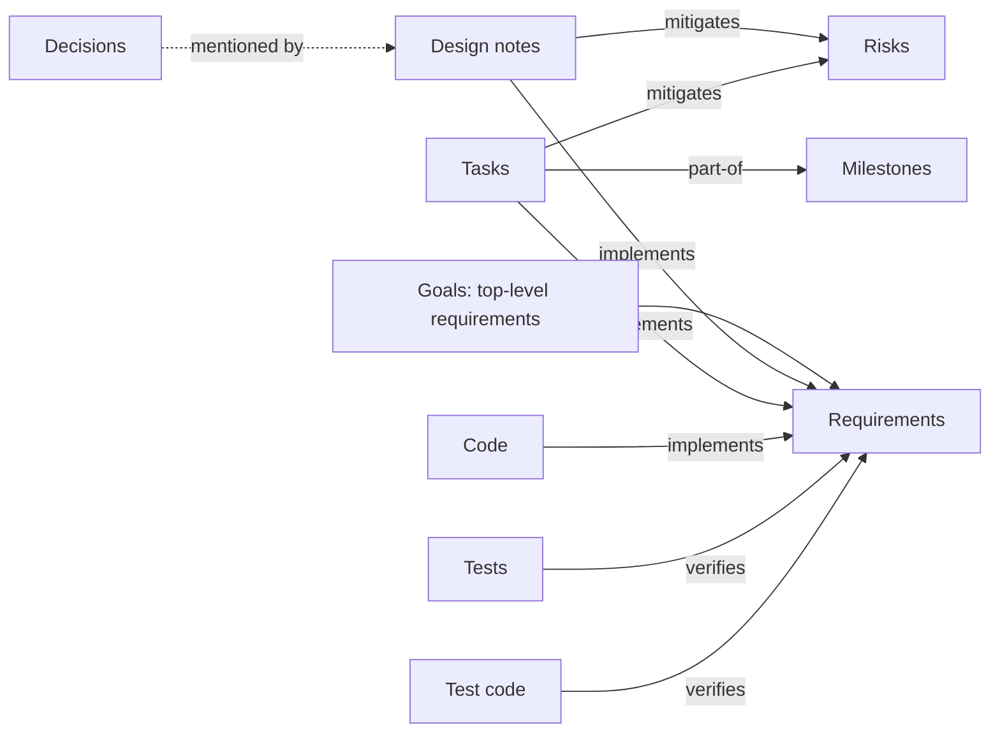

This page is the method. The [Tutorial](Tutorial) shows the commands;
this page explains how to design a whole project with them:

- which items to write, in what order, and how to word them;
- how to link them;
- how to shape the design document;
- how a team keeps the design true as the project moves.

Everything here was used to design real projects with Kiln, including
Kiln itself, whose own design lives in its repository under
[`design/`](https://github.com/tpedneault/kiln/tree/master/design).

## The shape of a Kiln design

A Kiln design is a set of small Markdown files, one per idea, connected
by links. The default types fit together like this:



Read the arrows as sentences: "DES-003 implements REQ-007", "TEST-012
verifies REQ-007", "TASK-004 is part of MS-002". Each link is written once,
in the front matter of the item at the arrow's tail. Kiln works out the
other direction ("REQ-007 is implemented by DES-003") and checks the gaps:

- an approved requirement nothing implements;
- an approved requirement nothing verifies;
- a reference to something that doesn't exist.

The work, roughly in order:

1. Agree on the **goals and non-goals**.
2. Turn the goals into **requirements**, each one precise and checkable.
3. Write the **design notes** that explain how the requirements will be
   met, and record each important **decision** with its reasons.
4. List the **risks** and link what mitigates them.
5. Plan **milestones** and **tasks**.
6. Plan how each requirement is **verified**: tests, test code.
7. Shape the **design document** with a template.
8. From then on, keep it true: **CI**, reviews, baselines.

You don't need to finish one step before starting the next. A first pass
over steps 1–7 can take an afternoon. Then the design grows with the
project.

## Before the first item

### Decide who reads the design

There are usually two audiences:

- **The team**, who read and edit the item files in the repository and
  use `kiln check`, `kiln show`, the GUI and their editor.
- **Everyone else**: managers, reviewers, other teams, customers. They read
  the generated document as a committed Markdown file, an HTML or Word file,
  or a Confluence page.

Write item bodies for the second audience. They are what ends up in the
document. Keep notes meant only for the team in commit messages and
review comments, not in items.

### Keep the default types unless you have a reason

`kiln init` declares seven types: requirement, design, decision,
milestone, task, test, risk. They cover most software projects. Change
them in `kiln.toml` ([Configuration](Configuration)) when your domain
needs it, for example:

- **Add a type** for something you track separately and link to: an
  `interface` (`IF`) that design notes implement, a `hazard` (`HAZ`) for
  safety analysis, a `story` (`US`) if your team writes user stories.
  Give it a prefix, statuses and the link roles it takes part in.
- **Remove a type** you won't use (`task`, if work is tracked in Jira).
  Fewer types is a simpler design.
- **Rename statuses** to match your process (`reviewed` instead of
  `approved`). Keep `initial`, `done` and `closed` in step: coverage
  warnings start after `initial`, and progress counts `done`.

Decide this early. Changing a type's prefix later means renumbering every
item of that type.

### Folders don't matter, so use the default

`kiln new` files items under `design/<type plural>/`. Kiln ignores
folders: hierarchy comes from `parent`, and grouping comes from types and
tags. Keep the default layout so everyone finds files the same way.

## Step 1: goals and non-goals

Start by writing down why the project exists, in a handful of sentences.
Two good places for this:

- **Top-level requirements**, one per goal ("REQ-001 The repository is the
  source of truth"). Specific requirements then become their children, so
  the document reads from purpose to detail, and the traceability matrix
  shows each goal covered through its children.
- **Prose in the document template** (a "Goals" and a "Non-goals"
  section). This suits goals that are context rather than something to
  verify.

Kiln's own design uses top-level requirements for its goals. Most
projects benefit from both: goals as requirements, plus a short
"Non-goals" list in the template. A non-goal ("not a build system", "no
mobile app in the first year") prevents more arguments than any
requirement.

## Step 2: requirements

A requirement says **what** the project must do or be, never how.

### Write one checkable statement per item

The title is the requirement, written as a statement that is either true
or false of the finished product:

| Instead of | Write |
|---|---|
| Performance | The window appears within 50 ms of the hotkey |
| Support Windows | Runs on Windows 10 and 11 without administrator rights |
| Good error messages | Every error names the file, line and column |
| Security | No secret is ever written to a log or an error message |

The body makes it precise enough to test:

- **Meaning:** what exactly is required, with numbers and units.
- **Measurement:** how it is checked (on what machine, at what
  percentile, with what data).
- **Rationale:** why, briefly, so a future reader can judge whether it
  still applies. A `## Rationale` heading works well.

```markdown
+++
id = "REQ-014"
type = "requirement"
title = "Flint appears within 50 ms of the hotkey"
status = "approved"
parent = "REQ-002"
tags = ["performance"]
+++

Measured from receipt of the hotkey to the first presented frame, at the
95th percentile, on the reference laptop with ten providers registered.

## Rationale

Anything slower stops being a reflex; see [[ADR-004]].
```

If a requirement needs "and" in its title, it is probably two
requirements. If it can't be verified, it is a goal: rewrite it until it
can, or make it the parent of requirements that can.

### Build a shallow tree

Use `parent` to break a requirement into more precise ones. Two or three
levels is plenty:

```text
REQ-002 Fast enough to be a reflex
  REQ-014 Flint appears within 50 ms of the hotkey
  REQ-015 A search answers within 16 ms per keystroke
```

A parent is covered when it is covered itself, or when all of its open
children are. You can link tests to the precise children and leave the
broad parent alone.

### Tag what cuts across the tree

Tags group requirements that belong to different branches:
`performance`, `security`, `platform`, `integration`. They let the
document have a "Performance" section, and `kiln list --tag performance`
shows them together. Tags are lowercase words. Keep the set small and
agree on it as a team.

### Move requirements through their statuses

The default lifecycle:

| Status | Means | Who moves it there |
|---|---|---|
| `draft` | being written; not agreed | whoever writes it |
| `proposed` | ready for review | the author, in a pull request |
| `approved` | agreed; the team commits to it | the reviewers, on merge |
| `implemented` | the code does it | the developer, with the change |
| `verified` | a passing test shows it | when the test passes |
| `obsolete` | no longer required | whoever retires it |

Coverage warnings start once a requirement passes its initial status,
`draft` by default. `proposed` and `approved` items with no implementing
or verifying link are flagged (rules K201 and K202). A `verified`
requirement with no passing evidence is flagged too (K205): no test item
with status `passing` and no test code verifies it.

**Never delete a requirement** that was ever approved. Set it to
`obsolete`. Its ID stays taken, the history stays readable, and links to
it raise a warning (K203) instead of an error. Deleting the file frees
the number: if it was the highest, the next `kiln new` hands it out
again, and old references would silently point at the new item.

### Requirements at several levels

One `requirement` type with a shallow tree suits most projects. When the
organisation writes requirements at several levels (a customer's
stakeholder requirements, the system specification, a software
specification per component; or DO-178C's high- and low-level
requirements), make each level a type and list them in `[requirements]`
([Configuration](Configuration#requirements-requirement-levels)) rather
than tagging one type:

- Each level gets its own prefix, statuses and section in the document,
  and its own reviewers.
- Lower levels `refines` the level above, written once on the lower
  side; `parent` stays for decomposition within a level.
- `kiln check` finds the requirement nobody refined (K210) and the one
  that refines nothing (K208); a requirement that is there because the
  design needs it, not because a level above asked, says `derived = true`
  and why.
- `kiln trace --levels` and the `levels` report show the chains, which is
  the matrix an assessor asks for.

Levels are cheap to add early and costly to retrofit: moving existing
requirements to a level means a new `type` and a new ID for each
(`kiln renumber`, which rewrites every reference). Decide before the
first review.

## Step 3: design notes and decisions

### Design notes explain how

A **design note** (`DES`) describes how a part of the system works:

- the architecture;
- a component;
- a file format, a protocol, a data model;
- an algorithm, a user interface.

Link it to the requirements it answers:

```toml
[links]
implements = ["REQ-001", "REQ-002"]
```

Good design notes:

- **Explain structure:** components, data and flows. A Mermaid diagram
  often says more than three paragraphs, and Kiln checks diagrams parse.
- **Show the concrete thing:** an example configuration file, a message,
  a table of states.
- **Say what is deliberately left out**, so a reader doesn't assume it was
  forgotten.
- **Refer to decisions** by ID (`see ADR-003`) rather than repeating their
  reasoning.

Use `parent` between design notes for a document that reads top-down:
"DES-001 Architecture", then children for each component.

### Decisions explain why

A **decision** (`ADR`, after Architecture Decision Record) is a choice
someone could reasonably have made differently. Write one whenever you
pick between real alternatives:

- TOML or YAML;
- one process or two;
- pipes or a terminal;
- polling or events.

Use the same three headings every time. Give the decision type a body
template so `kiln new decision` writes them for you
([Configuration](Configuration)):

```markdown
## Context

What forces the decision: the requirements, constraints and facts.

## Decision

What was chosen, in one or two sentences.

## Consequences

What follows, good and bad. What it costs; what it rules out.
```

Decisions are `proposed` while discussed and `accepted` once agreed. When
a later decision replaces one, don't edit the old one:

1. Write the new decision with `supersedes = ["ADR-004"]` in its `[links]`.
2. Set the old one to `superseded`.

The decision log then shows the whole story, and Kiln warns (K204) about
a superseded decision that nothing supersedes.

> [!NOTE]
> With the default types, `superseded` is a closed status. The new
> decision's `supersedes` link therefore points at a closed item, and
> Kiln warns about it (K203, "links to a closed item"). Choose one:
>
> - Accept that warning.
> - Remove `superseded` from the decision type's `closed` list in
>   `kiln.toml`.
> - Turn K203 off with `[check] K203 = "off"`.
>
> [Checking](Checking) explains the trade-off.

A decision that reduces a risk can say so. Add `"decision"` to the
`from` list of the `mitigates` role in `kiln.toml`, and link it:
`mitigates = ["RISK-004"]`.

## Step 4: risks

A **risk** names what could go wrong, how likely and how bad, and what
reduces it. Link what mitigates it from the design note, task, decision
or requirement that does:

```toml
# in DES-004
[links]
mitigates = ["RISK-003"]
```

The `risks` report lists every open risk with what mitigates it, so an
unmitigated risk stands out. Move risks to `mitigated` when the
mitigation is in place, `accepted` when you decide to live with it, and
`closed` when it no longer applies.

Good risks are specific: "The Confluence API differs between Cloud and
Data Center" is a risk; "Integration problems" is not.

## Step 5: milestones and tasks

A **milestone** (`MS`) is a deliverable step that leaves the product
usable: "E1: configuration and `run`", "First public release". A
**task** (`TASK`) is a piece of work. Link tasks to their milestone with
`part-of`, and to the requirements they deliver with `implements`:

```toml
[links]
part-of = ["MS-002"]
implements = ["REQ-009"]
mitigates = ["RISK-001"]
```

Kiln computes each milestone's progress: done tasks out of the total,
leaving closed ones out. It shows progress in `kiln show`, in the
roadmap report and on the GUI's Roadmap page. Give milestones a `due`
date (`due = 2026-11-30`) and Kiln warns (K206) when one passes its date
unfinished.

Order the work with `depends-on` between tasks. `kiln next` then lists
what is ready to start: open, not `blocked`, nothing it depends on still
open, earliest milestone first. `kiln status` shows the whole plan by
milestone, with what waits on what:

```console
$ kiln status
MS-002 E1: configuration and run · active · 1 of 3 done · due 2026-11-30
  ready    TASK-004  todo  Parse the configuration
  waiting  TASK-005  todo  Run the checks  (on TASK-004)
```

`kiln check` warns when the plan says more than the work: a milestone
marked done with open tasks (K211), a task done before what it depends
on (K212), an open task in no milestone (K213), a requirement marked
implemented while its tasks are open (K214).

A milestone's progress counts its own tasks only. `depends-on` between
milestones orders them; it neither adds the earlier milestone's tasks to
the later one's progress nor holds the later one's tasks back. To make a
task wait for another, link the tasks.

Several people, or several coding agents, share one plan by claiming
work: whoever takes a task sets its `owner` in the same command that
moves it on (`kiln set TASK-004 owner=ana status=doing`). `kiln next
--unowned` then leaves it out, and `kiln status` and the Board show who
has it. Kiln has no assignment beyond that: `owner` is a claim, not a
workflow.

**If your team uses Jira**, keep tasks in Jira and put the issue keys on
items (`jira = ["PROJ-123"]`), or keep Kiln tasks and link them to Jira.
Kiln deliberately has no assignees, estimates or sprints; it is not a
second tracker ([Jira](Jira)).

## Step 6: verification

Every approved requirement needs at least one thing that verifies it.
There are two kinds:

- **Test items** (`TEST`) describe a test as a document: a manual
  procedure, an acceptance test with a customer, a measurement on
  reference hardware, or a test you plan before writing it. Set its
  status to `passing` once it passes.
- **Test code** carries a code reference, as a comment just above the test:

  ```rust
  #[test]
  // verifies: REQ-014, REQ-015
  fn hotkey_to_first_frame_is_under_budget() { … }
  ```

  The comment marker doesn't matter. Kiln matches `verifies:` followed by
  IDs on any line of any file under `[code] paths`.

Prefer test code wherever a test can be automated: it can't drift out of
date the way a document can. Use test items for what can't be automated,
and for planning tests before the code exists. A planned `TEST` item in
`draft` already covers its requirement, so the gap is closed on paper;
change its status as the test becomes real.

Mark implementation code the same way with `// implements: REQ-…`. It
lets `kiln impact REQ-014` and the document point at the code that
answers each requirement.

## Step 7: the design document

The document is generated from a template: your own Markdown, with
directives where Kiln places items and reports. `kiln preset add
design-doc` writes one like this for you, and `kiln preset add arc42`
an arc42 one ([Presets](Presets)).
A template that works for most projects:

```markdown
# Introduction

<!-- kiln:summary -->

One paragraph: what the project is, and that this document is generated
from the repository's design/ folder.

<!-- kiln:toc -->

# Goals and non-goals

## Goals

The purpose in a few numbered points, referring to the top-level
requirements (REQ-001…).

## Non-goals

What the project deliberately doesn't do.

# Requirements

## Performance

<!-- kiln:items type="requirement" tag="performance" -->

## Everything else

<!-- kiln:items type="requirement" -->

# Design

<!-- kiln:items type="design" -->

# Decisions

<!-- kiln:items type="decision" status="accepted,superseded" -->

# Plan

<!-- kiln:report roadmap -->

<!-- kiln:items type="task" style="row" -->

# Risks

<!-- kiln:report risks -->

# Appendix: tests

<!-- kiln:items type="test" style="row" -->

# Appendix: traceability

<!-- kiln:report traceability -->

# Appendix: open findings

<!-- kiln:report findings -->
```

How placement works:

- **An item appears once.** A later directive skips what an earlier one
  placed. Put specific sections ("Performance") before general ones
  ("Everything else").
- **Children follow their parent.** Within a directive, items nest by
  `parent`.
- **`tag` takes a single tag**, with no negation. Only `status` accepts
  `!` (`status="!obsolete"`). For "everything not tagged X", rely on the
  appears-once rule: place the tagged sections first, then a general
  section catches the rest. Or give the remaining items a tag of their
  own.
- **`style="row"` puts many small items in one table:** ID, title,
  status and links, without bodies. It suits tasks and tests.
- **Check what's missing.** `kiln export --dry-run` lists open items no
  directive placed ("leaves out"). Check it after adding a section.
- **Prose is rendered like an item body.** IDs you mention in the
  template become links, and diagrams are drawn.

Declare one export target per audience and format:

- a committed Markdown file, kept current in CI with `kiln export
  --check`;
- a Word or HTML file for formal reviews;
- a Confluence page for the rest of the organisation.

They can share the template. [Templates and exports](Templates-and-exports)
has every directive and option.

## Step 8: keep the design true

A design is only useful while it matches the project. Kiln's job from
here is to make drifting loud.

### In every pull request

- **Edit items in the same pull request as the code they describe.**
  Reviewers then see the requirement change, the design note and the code
  together, as ordinary diffs.
- **Mark code as you write it** with `implements:` and `verifies:`.
- **Run `kiln check` in CI.** References, IDs, links and coverage are
  checked on every change.
- **Run `kiln export --check` in CI** when you commit the document. It
  fails when someone edits an item without regenerating.

### Tighten checks as the design settles

Start lenient: warnings show gaps without failing anything. Once the
first milestone is planned, promote the coverage rules in `kiln.toml`:

```toml
[check]
K201 = "error"   # an approved requirement nothing verifies fails CI
K202 = "error"   # an approved requirement nothing implements fails CI
```

From then on, approving a requirement means planning how it is built and
verified in the same change.

### With coding agents

`kiln init` writes `design/AGENTS.md`, which agents that read
`AGENTS.md` files pick up when they work in `design/`: rules for
changing the design through Kiln's commands, and a section generated
from `kiln.toml` describing your types, folders, links and exports.
Adapt the rules to your team (who may approve what, which items an agent
may create), and keep the generated section current with `kiln agents`;
`kiln check` reports it stale (K113).

Many agents read only the repository's own `AGENTS.md` (or `CLAUDE.md`)
at the root, not the one in `design/`. Add one line there pointing at
the design guide; `kiln init` and `kiln agents` print it when they write
a guide:

```markdown
The design (requirements, decisions, milestones and tasks) is in `design/`, kept with Kiln; read `design/AGENTS.md` before changing it or implementing what it describes, and `kiln next` lists the work ready to start.
```

With tasks in milestones, "do the next task" is a complete instruction:
the agent runs `kiln next`, reads the task with `kiln show` (body and
links, as JSON if it likes), moves it to `doing`, implements it with
code references to the requirements it `implements`, and sets it
`done` once `kiln check` is clean. It creates what it finds along the
way in one command each: `kiln new task --title "…" --link
part-of=MS-002 --body-file -`.

In review, treat an agent's design changes like anyone's: the front
matter changes are small and `kiln check` has run on them; read the
prose, and check that it hasn't moved a requirement to approved or
accepted a decision on its own.

### Two people, one ID

Two branches can each create `REQ-015`. After the second merge, `kiln
check` reports the duplicate (K101). Fix it with one command:

```console
$ kiln renumber REQ-015 --to REQ-016 --file design/requirements/REQ-015-the-second-one.md
```

When the ID isn't duplicated, `renumber` rewrites every reference to the
moved item: front matter, prose and code comments. When it is duplicated,
Kiln can't tell which item a reference meant. It moves only the chosen
item's ID and file name, and lists the references for you to check by
hand. Sequential, readable IDs are worth this occasional fix.

### Releases and reviews

Tag each release. Afterwards:

- `kiln diff v1.0` lists every item added, changed or removed since, with
  what changed (status, links, body).
- `kiln export --since v1.0` marks those items "New" or "Changed" in the
  document and adds a changes report, so a reviewer reads only what
  moved.
- The GUI's Changes page shows the same.

[Changes and baselines](Changes-and-baselines) has the details.

## How big should a design be?

- **Small project** (one person, a few weeks): 10–20 requirements, a few
  decisions, no tasks. One document.
- **Medium project** (a team, a few months): 30–80 requirements in a
  two-level tree, 10–20 design notes, 10–30 decisions, milestones with
  tasks, a risk list. One document, perhaps with a second browsable
  target.
- **Large project**: hundreds of items. Use the `sections` or `tree`
  layout for Confluence, and several documents for different audiences
  (one per subsystem, using `root=` or tags).

Kiln stays fast at this size. Its performance budget, enforced in its own
CI, is `kiln check` on 2,000 items and 50,000 source files within two
seconds.

## A checklist before calling a design ready

- [ ] Every goal is a top-level requirement or stated in the template.
- [ ] Non-goals are written down.
- [ ] Every requirement title is a checkable statement, with units where
      it has numbers.
- [ ] Every approved requirement is implemented by something and verified
      by something (`kiln check` shows no K201/K202).
- [ ] Every real choice between alternatives has a decision with context,
      decision and consequences.
- [ ] Every open risk is mitigated by something, or explicitly
      `accepted`.
- [ ] Milestones each leave the product usable, and their tasks are
      linked.
- [ ] `kiln export --dry-run` leaves out nothing by accident.
- [ ] `kiln check` and `kiln export --check` run in CI.

## Common mistakes

| Mistake | What happens | Instead |
|---|---|---|
| Writing a link on its target, such as `verified-by` in a requirement | K108 or K109 | Write it on the source: `verifies` in the test |
| Mentioning `REQ-001` in prose and expecting coverage | still K201 | Mentions don't count; add a `[links]` entry or a code reference |
| An ID from another project in prose, such as `ADR-010` | K102 if your project has an `ADR` prefix | Put it in a code span (`` `ADR-010` ``) or write it out in words |
| Forgetting `[code] paths` | code comments are ignored | Uncomment `[code]` in `kiln.toml` and list your source folders |
| `tag="!performance"` in a template | selects nothing | Rely on the appears-once rule or tag the rest |
| `kiln new` without `--body-file`, then never writing the body | K215 once the item moves on; the template's prompts reach the document | Replace each prompt with what the item says |
| Deleting an obsolete item | K102 everywhere it was linked | Set its status to `obsolete` |
| Editing the generated document | overwritten by the next export | Edit the items or the template |

See also: [Tutorial](Tutorial) · [Concepts](Concepts) ·
[Templates and exports](Templates-and-exports) · [Checking](Checking)
