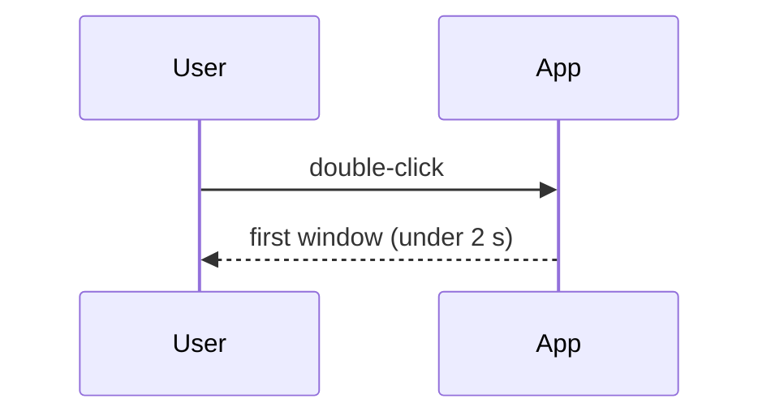

This page describes the file that holds one item: a requirement, a
decision, a task, a test, a risk or any other type your project declares.
It covers where item files live, every front-matter key, the Markdown you
can write in the body, how IDs work, how files are named, and how Kiln
edits your files. Read it when you write items by hand or want to know
exactly what Kiln accepts. The meaning of items, types, links and coverage
is explained in [Concepts](Concepts); the project file `kiln.toml` is
described in [Configuration](Configuration).

## Where items live

A Kiln project is a folder with a `kiln.toml` at its root, normally the
root of a git repository. Items are Markdown files (`.md`) inside the
folders listed in `paths` in `kiln.toml` (by default `["design"]`).

A `.md` file under those folders is an item when its **first line is
`+++`**. Anything else is ignored, so a `README.md` or a template inside
`design/` is fine. Files that `.gitignore` excludes are not read.

Everything is UTF-8. Kiln reads both `\n` and `\r\n` line endings and,
when it writes a file, keeps the ending the file already uses.

## The shape of an item file

An item file has two parts:

1. **Front matter**: TOML between a `+++` line and the next `+++` line.
   It holds the item's ID, type, title, status and links.
2. **Body**: everything after the closing `+++`. Markdown, written for
   people.

```markdown
+++
id = "REQ-014"
type = "requirement"
title = "The app starts within two seconds"
status = "approved"
parent = "REQ-001"

[links]
mitigates = ["RISK-003"]
+++

From a double-click on the icon to the first usable window, at the 95th
percentile, on the reference laptop.
```

Front matter is TOML, not YAML, because Kiln edits it (status, links) and
can do so while keeping your comments and layout, and because TOML has no
surprises with implicit types (`no` stays a string).

A file that starts with `+++` but has no closing `+++` line, or whose
front matter isn't valid TOML, is error K100 (see
[Checking](Checking#file-rules-k100k112)).

## Front-matter keys

| Key | Type | Required | Meaning |
|---|---|---|---|
| `id` | string | yes | The item's ID, `PREFIX-NNN` (see [IDs](#ids)). The ID in the file is authoritative; the file name is not. |
| `type` | string | yes | A type declared in `kiln.toml` as `[types.<name>]`. Its prefix must match the ID's prefix. |
| `title` | string | yes | One line, at most 200 characters. |
| `status` | string | yes | One of the type's `statuses`. |
| `parent` | string | no | The ID of the item above this one in the tree. Its type must be listed in this type's `parents`. |
| `tags` | array of strings | no | Free-form labels, lowercase. |
| `jira` | string or array of strings | no | Jira issue keys, such as `"DEMO-12"` or `["DEMO-40", "DEMO-41"]`. See [Jira](Jira). |
| `owner` | string | no | A name or handle. Informational only: Kiln assigns nothing. |
| `due` | date | no | A TOML local date, written without quotes: `due = 2026-11-30`. Meaningful for milestones and tasks. |
| `[links]` | table | no | Outgoing links: each key is a link role, each value an array of IDs. |
| `[extra]` | table | no | Anything your project wants to record. Kiln keeps it untouched and never interprets it. |

Any other top-level key is error K104, so a typo such as `stauts` is
caught instead of silently ignored. A missing required key, a value of the
wrong type (a `due` written as `"2026-11-30"` in quotes, a `tags` that is a
string), a title over 200 characters or on several lines, and a tag with
uppercase letters are K104 too.

### `id`, `type`, `title`, `status`

```toml
id = "TASK-021"
type = "task"
title = "Script the cold-start measurement"
status = "doing"
```

- `type` must name a `[types.*]` table in `kiln.toml` (else K104, which
  lists the declared types).
- The ID's prefix must be that type's prefix (else warning K106: a
  `REQ-005` with `type = "test"`).
- `status` must be one of that type's statuses (else K107, which lists
  them).

### `parent`

```toml
parent = "REQ-001"
```

`parent` builds the tree: a requirement can have sub-requirements, a task
sub-tasks. Which types may be a parent is set per type in `kiln.toml`
(`parents = ["requirement"]`). Folders carry no meaning; `parent` is the
only hierarchy. A parent that doesn't exist is K102, a parent of a type
that isn't allowed is K108, and a chain of parents that comes back to the
item is K103.

Children matter for coverage: a requirement counts as covered when all
its non-closed children are (see [Concepts](Concepts)).

### `tags`, `jira`, `owner`, `due`

```toml
tags = ["performance", "start-up"]
jira = ["DEMO-40", "DEMO-41"]
owner = "carol"
due = 2026-11-30
```

- Tags are free-form but must be lowercase (`Release` is K104). `kiln
  list --tag performance` filters by them.
- `jira` keys are shown and linked in exports, and read from Jira by
  `kiln list --jira`, the GUI and rule K207 when `[jira] url` is set.
- `owner` is shown, nothing more.
- `due` on a milestone is checked by K206 (a milestone past its date that
  is neither done nor closed). On other types it is shown only.

### `[links]`

```toml
[links]
implements = ["REQ-014"]
part-of = ["MS-002"]
depends-on = ["TASK-019"]
```

Each key is a **link role** declared in `kiln.toml` as `[links.<role>]`.
A link is written only on its **source** side, the item the role's
`from` allows. The other side sees it under the role's `inverse` name
(`implemented by`, `includes`, `blocks`) without anything being written
there.

The default roles from `kiln init`:

| Role | From | To | Reads from the other side as |
|---|---|---|---|
| `implements` | design, task, code | requirement | implemented by |
| `verifies` | test, code | requirement | verified by |
| `part-of` | task | milestone | includes |
| `supersedes` | decision | decision | superseded by |
| `mitigates` | requirement, design, task | risk | mitigated by |
| `depends-on` | task, milestone | task, milestone | blocks |

What can go wrong:

- A role that isn't declared, a role this item's type can't use, or a
  target whose type the role doesn't allow: K108.
- A target that doesn't exist: K102.
- An inverse written by mistake, such as `verified-by = ["TEST-031"]` in a
  requirement: warning K109, which tells you to write `verifies` in the
  test instead.
- A link from an open item to a closed one (a task that implements an
  obsolete requirement): warning K203.

`kiln link ID ROLE TARGET` and `kiln unlink ID ROLE TARGET` edit this
table for you and check all of the above before writing.

### `[extra]`

```toml
[extra]
priority = "must"
likelihood = "medium"
source = "customer workshop, 2026-09"
```

Use `[extra]` for fields your team needs that Kiln has no key for:
priority, likelihood and impact of a risk, a safety class, a customer
reference. Kiln preserves it through every edit and never interprets it.
It must be a table (else K104). Kiln does not currently display `[extra]`
values in `kiln show`, the GUI or exports, so don't rely on it for
anything readers must see; put that in the body.

## The body

The body is CommonMark with GitHub tables, task lists (`- [ ]`) and
strikethrough (`~~old~~`), plus the extensions below.

| You write | It means |
|---|---|
| `[[REQ-014]]` | A reference to an item. Exports show it as the ID and title, linked to the item. |
| `[[REQ-014\|custom text]]` | The same reference, shown with your text. |
| `REQ-014` in prose | Also a reference, when `[render] link_bare_ids = true` (the default). See [Bare IDs](#bare-ids-in-prose). |
| a ` ```mermaid ` fenced block | A diagram. Exports draw it; `kiln check` checks it parses (K111). |
| `> [!NOTE]` (also `[!TIP]`, `[!WARNING]`, `[!CAUTION]`, `[!IMPORTANT]`) | A callout, in GitHub's syntax. |
| `[notes](../../docs/lab.md)`, `` | A link or image to a file in the repository. Checked by K110. |

### References with `[[…]]`

```markdown
The decision is [[ADR-004]]; the test is [[TEST-031|the stopwatch test]].
```

Anything inside `[[` and `]]` (up to a `|`) must be a valid ID of an
existing item. `[[REQ-099]]` for a missing item and `[[settings]]`, which
isn't an ID at all, are both K102. So don't use `[[…]]` for anything else,
such as wiki-style links.

### Bare IDs in prose

With `[render] link_bare_ids = true` (the default), an ID written plainly
in a sentence is a reference too:

```markdown
REQ-002 says how start-up is measured.
```

A bare ID counts only when all of these hold:

- Its prefix is one declared in `kiln.toml`. With the default types, so
  `UTF-8`, `ISO-9001` or a Jira key like `DEMO-12` are never references.
- It is a whole word: not inside `X-REQ-014`, `REQ-014-draft` or a file
  name like `REQ-014-title.md`.
- It is not inside a code span, a code block, an HTML block or an HTML
  tag. Text *between* inline HTML tags still counts: in
  `<b>REQ-097</b>`, `REQ-097` is a reference.

A bare ID that counts must exist, or it is error K102. A bare ID with a
declared prefix but the wrong spelling, such as `REQ-7`, is K102 too and
names the right spelling (`REQ-007`).

This matters when you write about IDs that aren't Kiln items. If a
supplier's numbering happens to use one of your prefixes (say your tests
are `TEST-` and a supplier's test plan has `TEST-4410`), put it in a code
span:

```markdown
The supplier's own test `TEST-4410` covers the same case.
```

Set `[render] link_bare_ids = false` if you'd rather have only `[[…]]`
count. Explicit `[[…]]` references are always checked.

### Mentions are not links

References in the body (`[[…]]` and bare IDs) are **mentions**. They show
up as "mentioned by" in `kiln show` and in the GUI, but they carry no
role: they never count toward coverage, never appear as "implemented by"
or "verified by", and never make a milestone's progress. Coverage needs a
deliberate link: a `[links]` entry in front matter or a code reference
(see [Configuration](Configuration#code-code-references)).

```console
$ kiln show REQ-014
REQ-014 The app starts within two seconds
requirement · approved · design/requirements/REQ-014-the-app-starts-within-two-seconds.md:3
parent          REQ-001 The app is usable quickly
tags            performance, start-up
jira            DEMO-12
owner           alice
mitigates       RISK-003 Slow disks on old laptops
implemented by  TASK-021 Script the cold-start measurement
verified by     TEST-031 Start-up stopwatch
mentioned by    ADR-004 Keep settings in one TOML file, RISK-003 Slow disks on old laptops
coverage        implements: yes, verifies: yes
```

### Mermaid diagrams

````markdown

````

Exports draw the diagram with the same renderer `kiln check` uses, so a
diagram that passes the check draws. A diagram that fails to parse is
error K111 on the diagram's own line:

```text
design/designs/DES-002-flow.md:10:3: K111 error: diagram: invalid flowchart edge syntax -- A -->
```

How diagrams appear in each export format is on
[Templates and exports](Templates-and-exports).

### Callouts

```markdown
> [!WARNING]
> A cold start after a reboot counts. A start from the OS file cache is
> not enough.
```

The five kinds are `NOTE`, `TIP`, `IMPORTANT`, `WARNING` and `CAUTION`,
as on GitHub. Exports render them as callouts (in Word, as an indented
paragraph with a coloured bar).

### Relative links and images

```markdown
The set-up is in [the lab notes](../../docs/lab.md).


```

A link or image that isn't a URL names a file in the repository:

- relative to the folder of the item file, or, when it starts with `/`,
  relative to the project root (the folder with `kiln.toml`);
- it must exist and stay inside the project, else error K110;
- `#section` and `?query` parts are ignored when checking.

URLs (`https://…`), `mailto:` links and plain `#anchors` are not checked.

```text
design/requirements/REQ-003-settings-survive-an-upgrade.md:17:12: K110 error: `img/upgrade.png` doesn't exist (design/requirements/img/upgrade.png)
```

### Raw HTML

Raw HTML in a body is shown as text in exports, never passed through. Write
Markdown instead.

## IDs

### How an ID is spelt

An ID is a prefix, a hyphen and a number written with **at least three
digits**, zero-padded, with exactly one spelling per number:

| Valid | Not valid | Why |
|---|---|---|
| `REQ-007` | `REQ-7` | fewer than three digits |
| `REQ-014` | `REQ-0014` | an extra leading zero |
| `REQ-999`, `REQ-1000` | `req-014` | the prefix must be uppercase |

Prefixes are uppercase ASCII letters and digits, starting with a letter,
and unique across types (`REQ`, `TEST`, `HAZ1`). With one spelling per
number, a `grep` for `REQ-014` finds every mention, and IDs sort the same
as text and as numbers up to 999.

A wrongly spelt `id` in front matter is K104; in a reference it is K102.
Both name the right spelling:

```text
design/requirements/REQ-14.md:2:7: K104 error: id `REQ-14`: write it REQ-014 (at least three digits, no extra zeros)
design/requirements/REQ-003-settings-survive-an-upgrade.md:16:19: K102 error: reference `REQ-7` isn't how IDs are written: REQ-007
```

### How IDs are allocated

`kiln new TYPE` gives the new item the highest number already used for
that prefix, plus one. Items of every status count, including closed ones
such as `obsolete`, so a number is not handed out again while its file
exists.

IDs are sequential on purpose: `REQ-014` is easy to say in a meeting and
to remember. The price is that two people can pick the same number.

### Duplicates after a merge, and `kiln renumber`

When two branches each run `kiln new requirement`, both get the same next
number. After the merge, `kiln check` reports error K101 on every copy,
with the command that fixes it:

```console
$ kiln check
design/requirements/REQ-003-reuse-test.md:2:7: K101 error: REQ-003 is also the ID of design/requirements/REQ-003-settings-survive-an-upgrade.md; `kiln renumber REQ-003 --to REQ-004 --file design/requirements/REQ-003-reuse-test.md` moves this one
design/requirements/REQ-003-settings-survive-an-upgrade.md:2:7: K101 error: REQ-003 is also the ID of design/requirements/REQ-003-reuse-test.md; `kiln renumber REQ-003 --to REQ-004 --file design/requirements/REQ-003-settings-survive-an-upgrade.md` moves this one
kiln: 2 errors
```

While an ID is duplicated, the editing commands refuse to touch it. Run
the suggested `kiln renumber`. Because nobody can tell which item an
existing reference meant, only the chosen file's own ID and file name
change; the references are listed for you to check by hand:

```console
$ kiln renumber REQ-003 --to REQ-004 --file design/requirements/REQ-003-reuse-test.md
REQ-003 → REQ-004: 0 references in 0 other files; design/requirements/REQ-003-reuse-test.md → design/requirements/REQ-004-reuse-test.md
kiln: left alone: design/decisions/ADR-001-use-toml-for-settings.md:21 (may mean either REQ-003)
```

For an ID that isn't duplicated, `kiln renumber` moves the item and
rewrites every reference: `parent` and `[links]` in front matter,
`[[…]]` and bare IDs in bodies, and code references. It also renames the
file when its name starts with the old ID:

```console
$ kiln renumber REQ-002 --to REQ-010
REQ-002 → REQ-010: 3 references in 3 other files; design/requirements/REQ-002-start-up-time-is-measured-on-the-reference-laptop.md → design/requirements/REQ-010-start-up-time-is-measured-on-the-reference-laptop.md
```

The new ID must keep the same prefix. Text in code spans isn't a
reference and is left alone. In an editor connected to `kiln lsp`,
"rename" on an ID does the same (see [Editors and Flint](Editors-and-Flint)).

### Deleting versus marking obsolete

You may delete an item's file. Every reference to it then fails K102
until you remove the references. Prefer setting a closed status instead
(`kiln set REQ-008 status=obsolete`): the item stays readable in history
and exports leave it out by default.

Deleting has one more effect: `kiln new` counts only the files that
exist. If you delete the item with the highest number, the next `kiln new`
of that type hands out the same number again, and old references,
commit messages or Jira comments that name it now point at a different
item. Another reason to mark items obsolete rather than delete them.

## File names and folders

By convention an item lives at
`<first of paths>/<type plural, lowercase>/<ID>-<slug>.md`, and `kiln new`
writes exactly that:

```console
$ kiln new requirement --title "Start-up time is measured on the reference laptop" --parent REQ-001
design/requirements/REQ-002-start-up-time-is-measured-on-the-reference-laptop.md
```

- The folder is the type's `plural` in lowercase with hyphens
  (`requirements`, `designs`, `decisions`); a type `interface` with
  `plural = "Interfaces"` gets `interfaces/`.
- The slug is the title in lowercase, with anything that isn't a letter or
  digit turned into a hyphen, cut at a word boundary to at most 50
  characters.

You may move and rename files freely: folders carry no meaning, and the
`id` in the file is what counts. The one rule is that the file name should
**start with the ID**. If it doesn't, you get warning K105, because people
find files by name:

```text
design/tests/upgrade-test.md:2:7: K105 warning: the file name doesn't start with REQ-005
```

## Templates for new items

A type can name a template file whose content becomes the body of every
new item of that type. In `kiln.toml`:

```toml
[types.requirement]
prefix = "REQ"
statuses = ["draft", "proposed", "approved", "implemented", "verified", "obsolete"]
template = "design/templates/requirement.md"
```

The path is relative to the project root. The template is plain
Markdown, copied as is (there are no placeholders). Give it no front
matter, so it isn't read as an item even when it lives under `design/`:

```markdown
## Why

What goes wrong without this.

## How we know

The measurement that shows it is met.
```

```console
$ kiln new requirement --title "Settings survive an upgrade"
design/requirements/REQ-003-settings-survive-an-upgrade.md
```

The new file:

```markdown
+++
id = "REQ-003"
type = "requirement"
title = "Settings survive an upgrade"
status = "draft"
+++

## Why

What goes wrong without this.

## How we know

The measurement that shows it is met.
```

`kiln new` writes `id`, `type`, `title`, the type's `initial` status and,
with `--parent`, `parent`. Without `--title` the title is
`Untitled <type>`. A missing template file stops `kiln new` with an error
naming it.

## How Kiln edits your files

Only a few commands write item files: `kiln new`, `kiln set`, `kiln link`,
`kiln unlink` and `kiln renumber` (and the Flint provider's "set status"
action). They all follow the same rules:

- **Only the keys they are about change.** `kiln set REQ-001
  status=implemented` changes the `status` line and nothing else. Your
  comments, key order and spacing in the front matter survive.
- **The body is never touched**, except by `kiln renumber`, which rewrites
  the ID text of references and nothing else.
- **Writes are atomic.** A file is either the old version or the new one,
  never half written. The file's line ending and byte-order mark are kept.
- **A file changed since Kiln read it is refused.** If the file's
  modification time or length changed between reading and writing (you
  saved it in your editor at that moment), the command stops with exit 1
  and writes nothing. Run it again. Kiln and an editor never silently
  overwrite each other.
- **A duplicated ID is refused** until you renumber one copy.

```console
$ kiln set REQ-001 status=implemented
REQ-001: status approved → implemented
$ kiln link TASK-001 mitigates RISK-001
TASK-001 mitigates RISK-001
$ kiln link REQ-001 verifies REQ-002
kiln: a requirement can't be the source of `verifies` (from: test, code)
```

`kiln link` creates the `[links]` table and the role's array when needed;
`kiln unlink` removes the role, and `[links]`, when they become empty.

The language server (`kiln lsp`) computes the same edits with the same
code but never writes a file itself: it hands each change to your editor,
which applies it to the open buffer, where you can undo it.

## Formatting front matter

Through `kiln lsp`, your editor's "format document" tidies the front
matter. It is the one edit that touches keys it isn't "about":

- top-level keys go in this order: `id`, `type`, `title`, `status`,
  `parent`, `tags`, `jira`, `owner`, `due`, then any unknown keys, then
  `[links]` and `[extra]`;
- every string is written with double quotes (`"…"`).

Comments move with their key. Spacing, the body and everything else stay
as they are. There is no command-line equivalent.

## Complete examples

These files form one small, consistent project: `kiln check` on them
reports only the one warning explained under the decision. Comments in the
front matter are for this page; Kiln keeps them but doesn't need them.

### Requirement

`design/requirements/REQ-014-the-app-starts-within-two-seconds.md`:

````markdown
+++
# Front matter is TOML. Comments like this one survive every edit Kiln makes.
id = "REQ-014"                      # authoritative: the file name is only a convenience
type = "requirement"                # a [types.*] name from kiln.toml
title = "The app starts within two seconds"
status = "approved"                 # one of the type's statuses
parent = "REQ-001"                  # must be a type listed in the type's `parents`
tags = ["performance", "start-up"]  # lowercase, free-form
jira = "DEMO-12"                    # one key, or an array of keys
owner = "alice"                     # informational only

[links]                             # outgoing links: role = [target IDs]
mitigates = ["RISK-003"]

[extra]                             # anything your project wants; Kiln never interprets it
priority = "must"
source = "customer workshop, 2026-09"
+++

From a double-click on the icon to the first usable window, at the 95th
percentile, on the reference laptop.

## Rationale

People who wait longer than two seconds start the app twice. The
decision to keep settings small is [[ADR-004]]; the test that measures
this is [[TEST-031|the start-up stopwatch test]].

> [!NOTE]
> A cold start after a reboot counts. A start from the OS file cache is
> not enough.


The vendor's ticket `VND-77` is in a code span, so it is not a reference.
````

Notes:

- The requirement has no `implements` or `verifies` in its own front
  matter: those links are written by the task and the test below, and
  show up here as "implemented by" and "verified by".
- `mitigates` is written here because the role goes *from* requirement
  *to* risk.
- The image path is relative to the item's folder and must exist (K110).

### Decision

`design/decisions/ADR-004-keep-settings-in-one-toml-file.md`:

```markdown
+++
id = "ADR-004"
type = "decision"
title = "Keep settings in one TOML file"
status = "accepted"                 # proposed, accepted, rejected or superseded
owner = "bob"

[links]
supersedes = ["ADR-002"]            # the older decision becomes "superseded by ADR-004"
+++

## Context

Settings are read at every start (REQ-014) and edited by hand.

## Decision

All settings live in one TOML file per user.

## Consequences

- Comments in the file survive an upgrade.
- Settings written by older versions in YAML are converted once.
```

Notes:

- `REQ-014` in the context is a bare-ID mention: REQ-014 lists ADR-004
  under "mentioned by", but no coverage comes from it.
- ADR-002 has `status = "superseded"`. Rule K204 asks that some decision
  `supersedes` every superseded one, which this link does. With the
  default types, `superseded` is also a closed status, so this same link
  gets warning K203 ("ADR-004 links to ADR-002, which is superseded").
  That warning is expected for a supersedes link; see
  [Checking](Checking#k203) for how to handle it.

### Task

`design/tasks/TASK-021-script-the-cold-start-measurement.md`:

```markdown
+++
id = "TASK-021"
type = "task"
title = "Script the cold-start measurement"
status = "doing"                    # todo, doing, blocked, done or dropped
owner = "carol"
due = 2026-11-30                    # a TOML date, not a string
jira = ["DEMO-40", "DEMO-41"]

[links]
implements = ["REQ-014"]            # counts toward REQ-014's implements coverage
part-of = ["MS-002"]                # counts toward MS-002's progress
depends-on = ["TASK-019"]
+++

- [x] Reboot and launch from a script
- [ ] Record the 95th percentile in CI
```

With TASK-019 `done` and also `part-of = ["MS-002"]`, the milestone
shows half its work done:

```console
$ kiln show MS-002
MS-002 First release
milestone · active · design/milestones/MS-002-first-release.md:2
due       2026-12-15
includes  TASK-019 Set up the reference laptop, TASK-021 Script the cold-start measurement
progress  1 of 2 done
```

A milestone's progress also counts the items of every milestone it
`depends-on`, and of the milestones those depend on, and so on.

### Test

`design/tests/TEST-031-start-up-stopwatch.md`:

```markdown
+++
id = "TEST-031"
type = "test"
title = "Start-up stopwatch"
status = "passing"                  # draft, ready, passing, failing or obsolete

[links]
verifies = ["REQ-014"]              # counts toward REQ-014's verifies coverage
+++

## Steps

1. Reboot the reference laptop.
2. Double-click the icon and start the stopwatch.
3. Stop it when the main window accepts input.

## Expected

Under 2.0 s in 19 runs out of 20.
```

Any test that isn't closed (`obsolete`) counts for coverage, even a
`draft`. Only a test with status `passing` (or a code reference) lets a
requirement be `verified` without warning K205.

### Risk

`design/risks/RISK-003-slow-disks-on-old-laptops.md`:

```markdown
+++
id = "RISK-003"
type = "risk"
title = "Slow disks on old laptops"
status = "open"                     # open, mitigated, accepted or closed

[extra]
likelihood = "medium"
impact = "high"
+++

Customers with spinning disks may wait five seconds or more.

## Mitigation

REQ-014 sets the budget; TASK-021 measures it.
```

The risk lists nothing in `[links]`: `mitigates` is written by the
requirement, design or task that mitigates it, and the risk shows it as
"mitigated by". Likelihood and impact go in `[extra]` because Kiln has no
keys for them.

```console
$ kiln show RISK-003
RISK-003 Slow disks on old laptops
risk · open · design/risks/RISK-003-slow-disks-on-old-laptops.md:2
mitigated by  REQ-014 The app starts within two seconds
```

See also: [Concepts](Concepts), [Configuration](Configuration),
[Checking](Checking), [Tutorial: your first project](Tutorial)
