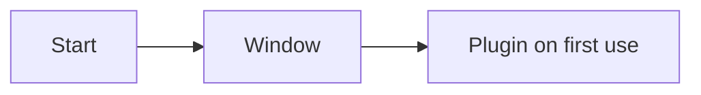

This page explains how Kiln turns your items into documents for people
who don't read the repository: a Markdown file, a self-contained HTML
file, a Word document or Confluence pages. It covers export targets,
layouts, templates and their directives, reports, the file formats,
diagrams, and how to keep a generated document current in CI. Read it
when you want a design document out of your project. Publishing to
Confluence has its own page, [Publishing to Confluence](Publishing-to-Confluence).

If you are new to items, links and coverage, read [Concepts](Concepts)
first.

## How an export works

Every export is a **target**: an `[[export]]` table in `kiln.toml` that
says what to include, how to arrange it (the **layout**) and what to
write it as (the **format**). `kiln export` runs every target; `kiln
export NAME` runs one.

For each target Kiln does the same five steps:

1. **Select** the items: by the template's directives, or by `types` and
   status when there is no template.
2. **Assemble** one document: sections, items with their properties and
   bodies, reports, section numbers, and an anchor for every item.
3. **Split** it by the layout: not at all (`document`), at each top-level
   section (`sections`), or at each section and each item (`tree`).
   Links between items are resolved after the split: same page means an
   anchor, another page means a link to that page (and anchor).
4. **Render** each page in the format.
5. **Write** the files (only those whose bytes changed), or plan and
   publish Confluence pages.

Because every target goes through the same steps, every layout works
with every format and every template.

## Export targets

A minimal target writes the whole design to one Markdown file:

```toml
[[export]]
name = "design-md"
format = "markdown"
path = "docs/DESIGN.md"
```

A fuller set, for several audiences:

```toml
[[export]]
name = "design-md"                    # `kiln export design-md`
format = "markdown"
title = "Demo — design document"
template = "design/templates/design-document.md"
path = "docs/DESIGN.md"               # committed, checked in CI

[[export]]
name = "design-html"
format = "html"
title = "Demo — design document"
template = "design/templates/design-document.md"
path = "target/kiln/design.html"      # under an ignored folder: a build artefact

[[export]]
name = "design-word"
format = "docx"
title = "Demo — design document"
template = "design/templates/design-document.md"
path = "target/kiln/design.docx"

[export.docx]
reference = "design/templates/company.docx"
```

Every key of `[[export]]`:

| Key | Default | Meaning |
|---|---|---|
| `name` | required | Unique. What `kiln export <name>` runs. For Confluence, part of every published page's identity. |
| `format` | required | `markdown`, `html`, `docx` or `confluence`. |
| `layout` | `document` | `document`, `sections` or `tree` (see [Layouts](#layouts)). |
| `title` | the project's `name` | The document's title. For Confluence, the (root) page title. |
| `template` | none | A Markdown file in the repository that arranges the document (see [Templates](#templates)). |
| `types` | every type, in `kiln.toml` order | Without a template: which types get a section. |
| `exclude_status` | each type's `closed` statuses | Without a template (and for `kiln:items` without `status=`): items left out. |
| `reports` | `["traceability", "findings"]` | Without a template: report sections added as appendices. `[]` for none. |
| `numbering` | `true` | Section numbers (`2.1.3`) on headings. |
| `item_style` | `list` for `document` and `sections`, `table` for `tree` | How an item's properties are shown (see [How items render](#how-items-render)). |
| `link_to` | `[]` | Other targets to link into for items this one doesn't contain, in order (see [link_to](#linking-between-targets-link_to)). |
| `path` | required for file formats | The output file (`document`) or folder (`sections`, `tree`), relative to the project root. |

Format-specific settings go in a sub-table that only that format reads:

| Table | Keys |
|---|---|
| `[export.markdown]` | `flavour` (`gitlab`, `github`, `commonmark`; default `gitlab`), `diagrams` (`source` or `image`; default `source`) |
| `[export.html]` | `theme` (only `light` exists so far, and is the default) |
| `[export.docx]` | `reference` (a `.docx` whose styles and page setup to use) |
| `[export.confluence]` | `parent` or `page`, `space`, `labels`, `toc_levels`, `restrict_adopted`, `qualify_titles`, `children` (see [Publishing to Confluence](Publishing-to-Confluence)) |

A sub-table belongs to the `[[export]]` written just above it in the
file, as TOML always works.

`kiln check` validates every target (rule K005: unknown format or layout,
duplicate name, a file format without `path`, a `link_to` naming no
target, and so on) and every template (rule K112). A broken export fails
the merge request, not the publish after it. `kiln export` refuses to run
a target that `kiln check` calls broken. See [Checking](Checking).

## Layouts

| Layout | Confluence | Markdown, HTML, Word |
|---|---|---|
| `document` (default) | one page holding the whole document | one file at `path` |
| `sections` | a root page with the opening material and a list of child pages; one child page per top-level section (each type section, each report) | a folder at `path`: `index.md` (or `.html`, `.docx`) plus one file per section |
| `tree` | as `sections`, and each item its own page under its section, nested by `parent` | a folder at `path`: `index.md`, then a folder per section with its own `index.md` and one file per item |

Here is what each layout wrote for the same small project in Markdown
(no template, so one section per type plus the two default reports):

```text
document   out/plain.md

sections   out/sections/index.md
           out/sections/requirements.md
           out/sections/designs.md
           out/sections/decisions.md
           out/sections/milestones.md
           out/sections/tasks.md
           out/sections/tests.md
           out/sections/risks.md
           out/sections/traceability.md
           out/sections/findings.md

tree       out/tree/index.md
           out/tree/requirements/index.md
           out/tree/requirements/REQ-001.md
           out/tree/requirements/REQ-002.md
           out/tree/requirements/REQ-003.md
           out/tree/designs/index.md
           out/tree/designs/DES-001.md
           …
           out/tree/traceability/index.md
           out/tree/findings/index.md
```

Which to choose:

- **`document`** is what a design document is: one thing to read top to
  bottom, print, review in one sitting and link to. In Confluence every
  change becomes one new version of one page, so "page history" and
  "compare versions" become the document's revision history. Start here.
- **`sections`** when the document grows past what one page carries
  well. For Confluence, Kiln warns when a page passes `max_page_kib`
  (see [Publishing to Confluence](Publishing-to-Confluence#size-limits-and-when-to-switch-layout)).
- **`tree`** when people browse and link to individual items more than
  they read the whole: a requirements database rather than a
  specification. Each item page shows the full properties table.

A target with more than one file (`sections`, `tree`) keeps a
`.kiln-export` list in its folder. When an item or section goes away,
Kiln removes the file it wrote earlier. It never removes a file it
didn't write.

## Documents without a template

Without `template`, a document contains, in order:

1. the title (the target's `title`, else the project name);
2. a summary: which commit it was generated from and that commit's date,
   a table of items by type and status, coverage (for example
   "Requirements: implemented by 2 of 3, verified by 2 of 3"), and the
   progress of each milestone;
3. a table of contents;
4. one section per type listed in `types` that has items, its items a
   flat list in which each parent is followed by its children (nested by
   `parent` in the `tree` layout);
5. the `reports` as appendices, lettered `A`, `B`, …

Items with a closed status (for example `obsolete` requirements) are left
out unless you change `exclude_status`. This is a real excerpt of a
template-less export:

```markdown
# Demo

Generated by Kiln from commit fada6eee526e (2026-10-14).

| Type | Items | By status |
| --- | ---: | --- |
| Requirements | 3 | proposed 1, approved 2 |
| Designs | 1 | accepted 1 |
…

Requirements: implemented by 2 of 3, verified by 2 of 3.

- [MS-001 Beta](#41-ms-001-beta): 0 of 1 done

- [1 Requirements](#1-requirements)
  - [1.1 REQ-001 The app starts quickly](#11-req-001-the-app-starts-quickly)
…
- [A Traceability](#a-traceability)
- [B Findings](#b-findings)

## 1 Requirements

### 1.1 REQ-001 The app starts quickly
…
```

This is a good way to start. Write a template when you want your own
introduction, scope, order of sections or prose between them.

## Templates

A **template** is a Markdown file in your repository (by convention under
`design/templates/`) that gives the document its own shape and prose.
Kiln fills it in through **directives**: HTML comments that start with
`kiln:`. Because they are comments, the template still reads as a plain
outline on GitLab or GitHub. Any other HTML comment is a note to whoever
edits the template: GitLab and GitHub hide it, and exports leave it out
too. (In an item's body, raw HTML is shown as text instead.)

You don't have to start from nothing: see
[Presets: arc42 and others](#presets-arc42-and-others).

### Directives

| Directive | Places |
|---|---|
| `<!-- kiln:items … -->` | the selected items, as a flat list, under the heading the directive sits in |
| `<!-- kiln:item REQ-014 -->` | exactly one item |
| `<!-- kiln:report NAME … -->` | a report: `traceability`, `findings`, `roadmap`, `risks` or `changes` (see [Reports](#reports)) |
| `<!-- kiln:summary -->` | the commit and its date, counts by type and status, coverage, milestone progress |
| `<!-- kiln:toc -->` | a table of contents: Confluence's `toc` macro, a Word TOC field, or a generated list in Markdown and HTML |
| `<!-- kiln:value name -->` | the project name, inline |
| `<!-- kiln:value commit -->` | the exported commit, inline |
| `<!-- kiln:value date -->` | that commit's date, inline |
| `<!-- kiln:value since -->` | the `--since` baseline, as `v1.0 (2ca625a)`; empty without `--since` (see [Changes and baselines](Changes-and-baselines)) |

The `kiln:report traceability` directive takes `type="…"` to trace
another type than `requirement`.

### `kiln:items` attributes

All attributes are optional. When you give several, an item must match
all of them.

| Attribute | Selects or does |
|---|---|
| `type="requirement,design"` | items of these types (comma-separated) |
| `status="approved,implemented"` | items with one of these statuses |
| `status="!obsolete"` | items without that status (the `!` negation works only for `status`) |
| `tag="performance"` | items with this tag. One tag only, no negation: `tag="a,b"` looks for a tag literally named `a,b`, and `tag="!x"` for a tag named `!x` |
| `root="REQ-002"` | that item and all its descendants by `parent` |
| `jira="FLINT-*"` | items with a matching Jira key (see [Jira](Jira)) |
| `nest="flat"` / `nest="parent"` | `flat` (the default, except in the `tree` layout): every item is a heading at the same level, each parent followed by its children, so the table of contents lists them all; `parent`: children are headings one level below their parent |
| `style="full"` | the default: each item as a heading, with its properties line and body |
| `style="row"` | all selected items as one table (ID, title, status, links), bodies left out. Suits many small items such as tests or decisions |
| `style="compact"` | each item as a bold "ID title" line with its body below, no heading and no properties. Suits items read for their prose, such as glossary terms: they keep their text without filling the table of contents |
| `split="auto"` / `split="no"` | in the `tree` layout, `no` keeps these items inline in their section page instead of a page each |

### Rules

- **An item appears once per document.** A later directive that selects
  an item an earlier one already placed skips it. So a section
  "Performance" with `tag="performance"` followed by "Everything else"
  with `type="requirement"` really gives everything else.
- **An item no directive selects is not in the document.** That is
  allowed, but `kiln export --dry-run` lists the open items each target
  leaves out (see [Dry runs](#dry-runs-and-leaves-out)), so an omission is
  a decision, not an accident.
- **An explicit `status=` decides on its own.** It can include statuses
  the target would exclude by default: `status="accepted,superseded"`
  shows superseded decisions though `superseded` is a closed status.
  Without `status=`, closed items are left out.
- **Nesting.** Items keep their `parent` nesting within one directive.
  An item whose parent isn't placed by the same directive starts at the
  directive's own level.
- **Row and compact items.** Items placed with `style="row"` or `style="compact"` have no heading. In
  HTML, Word and Confluence each row carries an anchor named by the ID, so
  references land on the row; GitLab and GitHub keep no anchors of Kiln's
  making, so in Markdown a reference to a row item links to the section
  holding the table.
- **Report rows.** Items that a report lists (the roadmap's milestones,
  the risks report's risks) and that nothing else placed are placed on
  their row in the report, after everything else. A report never takes an
  item away from a later `kiln:items`. Tasks that a roadmap shows under
  "Includes" are not placed by it: they still count as left out.
- **Heading levels.** The template's shallowest heading level is the
  document's top level, so you may use `#` or `##` for your sections.
  Sections and items use levels 1 to 6 by depth. In a file, the
  document's title is the first heading, so your top-level sections start
  one level below it (`##`). In Confluence the page title is the
  document's title and sections start at level 1. Below level 6, items
  keep their number (`2.1.3.1.2.1`) on a level-6 heading. Headings inside
  an item's body are moved under the item's level; those that would pass
  level 6 become bold paragraphs.
- **Numbering.** The template's own headings are sections, numbered with
  everything else (unless `numbering = false`).
- **Prose.** Template prose is rendered like an item body: references
  (`[[REQ-014]]`, and bare IDs such as REQ-014), Mermaid diagrams and
  callouts (`> [!NOTE]`) all work. A bare ID with a prefix your project
  declares is a reference, and an error (K102) if no such item exists. To
  write a foreign ID that happens to share a prefix, put it in a
  `code span`.

### Presets: arc42 and others

Kiln ships a few templates ready to use, as **presets**. `kiln preset
list` names them; `kiln preset add NAME` copies one into your project
(or `kiln init --preset NAME` starts a project with one):

| Preset | What you get | Layout |
|---|---|---|
| `arc42` | arc42 architecture documentation (arc42.org): its twelve sections | `sections`: a main page listing one page per section |
| `srs` | a software requirements specification after the outline of ISO/IEC/IEEE 29148, requirements sorted into its sections by tag | `document` |
| `design-doc` | a design document: goals, requirements, design, decisions, milestones, risks, traceability | `document` |

A preset brings three things, and then they are yours:

1. **The template**, `design/templates/NAME.md`, with guidance for each
   section in HTML comments (left out of the export) and placeholder
   sentences to replace. Delete the sections you don't need, add your
   own, move them around.
2. **The types it places**, added to `kiln.toml` if you don't have them
   yet, each with a comment saying what it is for. For arc42:

   | arc42 section | Kiln |
   |---|---|
   | 1.2 Quality goals | `quality-goal` items (QG), as a table |
   | 2 Constraints | `constraint` items (CON), as a table |
   | 3, 4, 6, 7, 8 Context, strategy, runtime, deployment, concepts | prose and Mermaid diagrams in the template |
   | 5 Building block view | `block` items (BB), nested by `parent`: levels 1, 2, 3 |
   | 9 Architecture decisions | `decision` items (ADR) |
   | 10 Quality requirements | `quality-scenario` items (QS), each with its goal as `parent` |
   | 11 Risks and technical debt | `risk` items and the risks report |
   | 12 Glossary | `term` items, `style="compact"`: the body is the definition |

   Decisions and blocks can link to the goals they serve
   (`addresses`) and the risks they reduce (`mitigates`).
3. **An export target** named after the preset, writing Markdown, and the
   same target for Confluence commented out below it. For a shared
   Confluence space it sets `qualify_titles = "always"`, so two projects
   using the same preset don't fight over "1 Introduction and Goals" (see
   [Publishing to Confluence](Publishing-to-Confluence#several-projects-in-one-space)).

```console
$ kiln init --name Shop --preset arc42
$ kiln new quality-goal --title "Pages answer within a second"
$ kiln new quality-scenario --title "Search under load" --parent QG-001
$ kiln export arc42
```

A newer Kiln never changes a preset you have added: it was copied, not
linked. The presets follow arc42's and the standard's structure; their
wording is Kiln's own.

### Template errors (K112)

`kiln check` reports every problem in a template as K112, with the
template's file and line: an unknown directive or attribute, an unknown
type, status or ID, a template file that doesn't exist, or a Word
`reference` document that doesn't exist or isn't a `.docx`. For example:

```console
$ kiln check
design/templates/design-document.md:33:1: K112 error: `requirment` isn't a type
design/templates/design-document.md:34:1: K112 error: kiln:items has no attribute `colour` (type, status, tag, root, jira, style, split, nest)
design/templates/design-document.md:35:1: K112 error: kiln:item `REQ-099` isn't an item
design/templates/design-document.md:36:1: K112 error: unknown directive kiln:foo (items, item, report, summary, toc, value)
kiln: 4 errors, 2 warnings
```

`kiln export` then refuses that target with one line and exit code 2:

```console
$ kiln export design-md
kiln: design/templates/design-document.md:33:1: K112 error: `requirment` isn't a type (`kiln check` lists every problem)
```

A template shared by several targets is checked once.

## A worked example

This is a complete template for a small desktop app with requirements,
designs, decisions, a milestone, a task, a test and a risk. Save it as
`design/templates/design-document.md`:

```markdown
# Introduction

<!-- kiln:summary -->

This document describes <!-- kiln:value name -->, a desktop app that
starts fast and works without a network. It is generated from the files
under `design/`; edit those, not this document.

<!-- kiln:toc -->

# Scope

Demo runs on Windows and Linux. Mobile is out of scope.

# Requirements

<!-- kiln:items type="requirement" -->

# Design

<!-- kiln:items type="design" -->

# Decisions

<!-- kiln:items type="decision" status="accepted,superseded" style="row" -->

# Plan

<!-- kiln:report roadmap -->

# Tests

<!-- kiln:items type="test" style="row" -->

# Appendix: traceability

<!-- kiln:report traceability type="requirement" -->

# Appendix: risks

<!-- kiln:report risks -->

# Appendix: open findings

<!-- kiln:report findings -->
```

And the target in `kiln.toml`:

```toml
[[export]]
name = "design-md"
format = "markdown"
title = "Demo — design document"
template = "design/templates/design-document.md"
path = "docs/DESIGN.md"
```

A dry run first shows what would be written and what is left out (the
task: no directive places tasks, and the roadmap only lists it):

```console
$ kiln export design-md --dry-run
design-md (markdown, document) → docs/DESIGN.md
  would update docs/DESIGN.md
  leaves out: TASK-001
```

Then `kiln export design-md` writes `docs/DESIGN.md`. An excerpt of the
real output:

````markdown
# Demo — design document

## 1 Introduction

Generated by Kiln from the files in this repository.

| Type | Items | By status |
| --- | ---: | --- |
| Requirements | 3 | proposed 1, approved 2 |
…

Requirements: implemented by 2 of 3, verified by 2 of 3.

- [MS-001 Beta](#6-plan): 0 of 1 done

This document describes Demo, a desktop app that starts fast and works without a network. It is generated from the files under `design/`; edit those, not this document.

- [1 Introduction](#1-introduction)
- [2 Scope](#2-scope)
- [3 Requirements](#3-requirements)
  - [3.1 REQ-001 The app starts quickly](#31-req-001-the-app-starts-quickly)
  - [3.2 REQ-002 Cold start under one second](#32-req-002-cold-start-under-one-second)
  - [3.3 REQ-003 Works offline](#33-req-003-works-offline)
…

## 3 Requirements

### 3.1 REQ-001 The app starts quickly

**approved**

### 3.2 REQ-002 Cold start under one second

**approved**\
**Parent:** [REQ-001 The app starts quickly](#31-req-001-the-app-starts-quickly)\
**Mitigates:** [RISK-001 Slow disks on old laptops](#9-appendix-risks)\
**Implemented by:** [DES-001 Lazy loading of plugins](#41-des-001-lazy-loading-of-plugins), [TASK-001 Implement plugin loader](../design/tasks/TASK-001-implement-plugin-loader.md)\
**Verified by:** [TEST-001 Measure cold start](#7-tests)

Measured from launch to the first usable window on the reference laptop. See [ADR-001 Use SQLite for local storage](#5-decisions) for why storage opens fast.

…

## 4 Design

### 4.1 DES-001 Lazy loading of plugins

**accepted**\
**Implements:** [REQ-002 Cold start under one second](#32-req-002-cold-start-under-one-second)

Plugins load on first use, not at start.



## 5 Decisions

| ID | Title | Status | Links |
| --- | --- | --- | --- |
| ADR-001 | Use SQLite for local storage | **accepted** |  |

## 6 Plan

| Milestone | Title | Due | Status | Progress | Includes |
| --- | --- | --- | --- | --- | --- |
| MS-001 | Beta | 2026-12-01 | **active** | 0 of 1 done | [TASK-001](../design/tasks/TASK-001-implement-plugin-loader.md) |

…

## 8 Appendix: traceability

3 requirements: implemented by 2 of 3, verified by 2 of 3.

| Requirement | Title | Status | Implemented by | Verified by |
| --- | --- | --- | --- | --- |
| [REQ-001](#31-req-001-the-app-starts-quickly) | The app starts quickly | **approved** | through its children | through its children |
| [REQ-002](#32-req-002-cold-start-under-one-second) | Cold start under one second | **approved** | [DES-001](#41-des-001-lazy-loading-of-plugins), [TASK-001](../design/tasks/TASK-001-implement-plugin-loader.md) | [TEST-001](#7-tests) |
| [REQ-003](#33-req-003-works-offline) | Works offline | **proposed** | **gap** | **gap** |
…
````

Things to notice:

- The summary names no commit ("Generated by Kiln from the files in this
  repository") because `docs/DESIGN.md` is committed in the repository
  (see [Committing an export](#committing-an-export-and-checking-it-in-ci)).
- TASK-001 isn't in this document, so links to it go to its file in the
  repository.
- Links to rows (ADR-001, TEST-001, RISK-001) land on the section that
  holds the table, because GitLab and GitHub keep no row anchors.
- Body text is reflowed: the line breaks of a paragraph in the item file
  don't matter.

## How items render

An item placed with `style="full"` becomes a numbered heading with an
anchor named by its ID, its properties, and its body. Its children follow
it as headings of the same level (or one level deeper with
`nest="parent"`):

```text
2.1.3  REQ-014 Flint appears within 50 ms of the hotkey   ← heading, anchor "REQ-014"
approved                                                  ← properties (item_style = "list")
Parent: REQ-002 Flint is fast
Verified by: TEST-031 Hotkey timing, TEST-032 Cold start
Jira: FLINT-88
<body>
2.1.4  REQ-031 …                                          ← a child: the next heading, same level
```

`item_style` sets how the properties are shown:

| `item_style` | Shows | Default for |
|---|---|---|
| `list` | the status, then one line per relationship with its label in bold: parent, outgoing links, inverse links ("Implemented by", "Verified by", with code locations), Jira keys | `document`, `sections` |
| `line` | the same on one line, joined with `·`: the most compact, for long documents whose items have few links | — |
| `table` | the full properties table: status, type, parent, each link role, source file | `tree`, where each item is a page of its own |
| `none` | heading and body only, for documents meant to read as prose | — |

A real `table` item page from a `tree` export:

```markdown
# REQ-002 Cold start under one second

| Property | Value |
| --- | --- |
| Status | **approved** |
| Type | Requirement |
| Parent | [REQ-001 The app starts quickly](REQ-001.md) |
| Mitigates | [RISK-001 Slow disks on old laptops](../risks/RISK-001.md) |
| Implemented by | [DES-001 Lazy loading of plugins](../designs/DES-001.md), [TASK-001 Implement plugin loader](../tasks/TASK-001.md) |
| Verified by | [TEST-001 Measure cold start](../tests/TEST-001.md) |
| Source | design/requirements/REQ-002-cold-start-under-one-second.md |
```

Statuses show as a coloured lozenge in HTML, Word and Confluence and in
bold in Markdown. Jira keys link to `<[jira] url>/browse/<KEY>` when
`[jira] url` is set (in Confluence they can be the live Jira macro
instead, see [Jira](Jira)).

A reference to an item that the document doesn't contain becomes a link
into a `link_to` target if one has it, else a link to the item's file in
the repository, else plain text (when there is no way to link to the
repository, see [Links to repository files](#links-to-repository-files-and-which-commit-they-name)).

## Reports

| Report | Content |
|---|---|
| `traceability` | for each non-closed item of the traced type (default `requirement`, or `type="…"`): what implements it, what verifies it, gaps marked. An item covered only through its children says "through its children". |
| `findings` | the `kiln check` warnings and errors, by rule, with the file and line |
| `roadmap` | milestones in `due` order: due date, status, progress, the items they include |
| `risks` | open risks and what mitigates them |
| `changes` | with `kiln export --since REV`: a line of totals, then one row per item added, changed or removed, with what changed. Without `--since` it says how to get one. See [Changes and baselines](Changes-and-baselines). |

A milestone's progress counts the items `part-of` it and also those of
any milestone it `depends-on`, transitively. See
[Concepts](Concepts) for how progress is computed.

In the `sections` and `tree` layouts, each report gets its own page or
file.

## Formats

### Markdown

CommonMark with GitHub tables, readable on GitLab and GitHub.

```toml
[export.markdown]
flavour = "gitlab"     # gitlab | github | commonmark: how heading anchors are formed
diagrams = "source"    # source: keep ```mermaid blocks | image: PNG files beside the document
```

- **Anchors.** Headings start with the number and the ID, so anchors are
  predictable. Kiln computes them with the flavour's own rules and links
  with them. GitLab and GitHub differ (GitLab collapses repeated `-`), so
  set `flavour = "github"` for a document read on GitHub. `commonmark`
  adds an explicit `<a id="REQ-014"></a>` before each item heading.
- **Diagrams.** With `diagrams = "source"` (the default), Mermaid blocks
  stay as code, and GitLab and GitHub draw them. With `diagrams = "image"`,
  Kiln writes PNG files beside the page and puts the source after each
  picture in a `<details>` block.
- **Images** from the repository link relatively when the export is
  inside the repository, and to the raw file on the web when it isn't.

### HTML

One self-contained file per page: styles inline, images and diagrams as
`data:` URIs, no scripts, no network fetches. You can e-mail it or attach
it to a release, and it opens offline.

- A print stylesheet starts top-level sections on a new page, shows link
  URLs and hides navigation, so the browser's **Print to PDF** gives a
  decent PDF. That is Kiln's answer for PDF.
- Light theme. `[export.html] theme` accepts only `light` so far; any
  other name is a `kiln check` error (K005).
- A remote image (an `https:` URL) is never fetched; it shows as its alt
  text.
- Each diagram is drawn as a picture, with its source in a collapsed
  "Diagram source" block.

### Word (`docx`)

For organisations whose formal reviews run on Word documents. One `.docx`
per page:

- Headings use Word's own **Heading 1–6** styles, so the navigation pane
  and Word's table of contents work. Deeper headings are bold paragraphs.
- Every item heading is a **bookmark** named after its ID with `_` for
  `-` (`REQ_014`), because Word bookmark names allow only letters, digits
  and `_`. References link to it, across files too in `sections` and
  `tree`.
- `<!-- kiln:toc -->` becomes Word's TOC field over headings 1–3, already
  filled with links so the document reads right at once.
- **What Word does on open:** the file asks Word to update fields when it
  opens, which adds page numbers to the table of contents. Word asks you
  before updating them; answering yes is safe.
- Top-level sections after the first start on a new page. Tables have
  borders and repeat their header row across pages. Repository images
  (PNG, JPEG, GIF) and diagrams are embedded, scaled to the page width.
  Remote images show as their alt text.
- Section numbers, bullets and list numbers are plain text, so a
  reference document's numbering can't clash with them.
- Status lozenges are white bold text on a coloured background; callouts
  and quotes are indented paragraphs with a coloured bar.

A **reference document** gives the house style:

```toml
[export.docx]
reference = "design/templates/company.docx"   # relative to the project
```

Kiln takes its styles (adding the ones Kiln needs that it lacks), theme,
numbering definitions, and the last section's page size and margins. It
doesn't copy headers and footers. Without a reference, the document is A4
with 2.54 cm margins in Calibri 11. A reference that doesn't exist or
isn't a `.docx` is a K112 error.

### Confluence

Storage format, published through a planner that detects edits made in
Confluence. All of it is on [Publishing to Confluence](Publishing-to-Confluence).

## Diagrams

Write a diagram as a fenced ` ```mermaid ` block in an item body or in
template prose. `kiln check` parses each one (rule K111), with the same
renderer exports use, so a diagram that passes the check draws.

Kiln draws diagrams as PNG pictures (at scale 2, on white) when the
format needs pictures:

| Format | Diagrams |
|---|---|
| Confluence | always pictures (attached to the page), unless `[confluence] diagrams = "source"` |
| HTML | always pictures (embedded as `data:` URIs) |
| Word | always pictures (embedded) |
| Markdown | source by default (GitLab and GitHub draw Mermaid); pictures with `diagrams = "image"` |

The source follows each picture in a collapsed "Diagram source" block,
except in Word.

**Fonts.** Drawing text needs fonts, and Kiln uses the system's fonts.
Slim CI images often have none, which would give diagrams without text.
Kiln checks first and stops with:

```text
no fonts found for diagrams: install fonts-dejavu (Debian/Ubuntu), or set diagrams = "source"
```

Install a font package in your CI image (`fonts-dejavu` on Debian or
Ubuntu), or keep diagrams as source where the format allows it (Markdown,
and Confluence with `[confluence] diagrams = "source"`).

**Cache.** Pictures are cached in Kiln's state folder (`state/diagrams`,
under `~/.local/state/kiln` on Linux, `%LocalAppData%\kiln` on Windows,
or under `KILN_HOME` when set), keyed by the diagram source, the renderer
version and the scale. CI can cache that folder between runs. The same
hash names the picture (`diagram-<12 hex>.png`), so a Confluence dry run
knows every attachment without drawing anything. You can delete the
cache at any time.

## Determinism

The same project at the same commit exports byte-identical output, on
Windows and on Linux. Everything without a natural order is sorted, line
endings are normalised, and the time of the export never appears (the
summary shows the commit and that commit's date). Word files are
deterministic too: a fixed zip time and no creation date.

The one exception is pictures of diagrams: their pixels depend on the
fonts a machine has. An HTML or Word export with diagrams (or Markdown
with `diagrams = "image"`) is byte-identical only between machines with
the same fonts. Picture names come from the diagram source, not the
pixels, so they don't change.

This is why you can commit an export and check it in CI.

## Committing an export and checking it in CI

A common setup: commit a generated `docs/DESIGN.md` next to the design,
so people browsing the repository read the document, and fail CI when
someone changes an item without regenerating it.

```toml
[[export]]
name = "design-md"
format = "markdown"
title = "Demo — design document"
template = "design/templates/design-document.md"
path = "docs/DESIGN.md"

[export.markdown]
flavour = "github"
```

In CI, run:

```console
$ kiln export --check
design-md (markdown, document) → docs/DESIGN.md
  would update docs/DESIGN.md
  leaves out: TASK-001, TEST-001, TEST-002
kiln: exports are out of date; run `kiln export` and commit the result
```

`--check` renders everything, writes nothing, and exits 1 when any file
would change. When everything is current:

```console
$ kiln export --check
design-md (markdown, document) → docs/DESIGN.md
  unchanged (1 file)
  leaves out: TASK-001, TEST-001
```

The fix is always to run `kiln export` locally and commit the result.

**In-tree exports.** A target whose `path` is inside the repository and
not ignored by git is **in-tree**. It can't name the commit that will
contain it (that commit doesn't exist yet when the file is written, so
`--check` could never pass). So an in-tree export:

- links to repository files with relative paths (with `#L<line>` for code
  locations), which GitLab and GitHub resolve at the revision you are
  viewing;
- says "Generated by Kiln from the files in this repository" in its
  summary instead of naming a commit; `kiln:value commit` renders as
  "this revision" and `kiln:value date` as nothing.

A file under an ignored folder (`target/kiln/design.html`) is not
in-tree, and links to the web like a Confluence page does.

An in-tree export that shows code locations goes stale when code above a
referenced line moves. `--check` reports it, and `kiln export` fixes it.

See [Continuous integration](Continuous-integration) for complete CI
files.

## Links to repository files and which commit they name

When an export isn't in-tree (an HTML file under `target/`, a Confluence
page), links to repository files (an item's source, a code location, a
relative link or image in a body) are web URLs. Set the URL pattern in
`kiln.toml`:

```toml
[repository]
web = "https://gitlab.example.com/acme/demo/-/blob/{commit}/{path}#L{line}"
```

Each link names **the last commit that changed that file**, not the
commit being exported. A real link from an export at a later commit to a
decision file that hasn't changed since the first commit:

```markdown
See [ADR-001 Use SQLite for local storage](https://gitlab.example.com/demo/demo/-/blob/fada6eee526e7cdf4a3caf97743b8f38f3c4daae/design/decisions/ADR-001-use-sqlite-for-local-storage.md) for why storage opens fast.
```

Why: if links named the exported commit, every merge would change every
page that links to code, and Confluence's page history would fill with
versions that change nothing a reader cares about. With this rule, output
changes only when something it shows changed. The summary, which names
the exported commit, is the one place that changes on every commit.

Without `[repository] web`, such links are plain text.

### Shallow clones

Finding the last commit per file needs the full git history. CI systems
often clone only the latest commit. In a shallow clone, a target that
isn't in-tree stops with:

```console
$ kiln export plain --dry-run
kiln: the clone is shallow: fetch full history (GitLab: GIT_DEPTH: 0; GitHub: fetch-depth: 0), or pass --allow-shallow
```

Fetch full history in CI (`fetch-depth: 0` in GitHub Actions'
`actions/checkout`, `GIT_DEPTH: 0` in GitLab). `--allow-shallow` exports
anyway, and links files older than the clone's boundary at the exported
commit instead. In-tree targets use relative links and don't need the
history.

## Dry runs and "leaves out"

`kiln export --dry-run` renders every target and prints what would
change, without writing anything:

```console
$ kiln export --dry-run
design-md (markdown, document) → docs/DESIGN.md
  would create docs/DESIGN.md
  leaves out: TASK-001, TEST-001
design-html (html, document) → out/design.html
  would create out/design.html
  leaves out: TASK-001, TEST-001
plain (markdown, document) → out/plain.md
  would create out/plain.md
```

"leaves out" lists the open (non-closed) items that no part of the
document placed. With a template, this is how you find an item you
forgot: add a directive for it, or accept that this audience doesn't need
it. Template-less targets show the line only when their `types` leave
something out.

Other options of `kiln export` worth knowing here:

| Option | Does |
|---|---|
| `--check` | like `--dry-run`, and exits 1 if anything would change |
| `--require-clean` | refuses when the working tree has uncommitted changes (exit 2) |
| `--allow-shallow` | exports from a shallow clone (see above) |
| `--since REV` | marks items new or changed since `REV` and fills the `changes` report ([Changes and baselines](Changes-and-baselines)) |
| `--format json` | the outcome per target as JSON |

The full list is in the [Command reference](Command-reference).

## Several targets for different audiences

One project can have as many targets as it has audiences. Each runs
independently, and `kiln export NAME` runs only the one you name.

```toml
# For the team, browsing the repository: everything, committed.
[[export]]
name = "design-md"
format = "markdown"
template = "design/templates/design-document.md"
path = "docs/DESIGN.md"

# For a formal review on paper: the same document in Word.
[[export]]
name = "review-docx"
format = "docx"
title = "Demo — design review"
template = "design/templates/design-document.md"
path = "target/kiln/design-review.docx"

# For stakeholders: requirements only, read as prose.
[[export]]
name = "requirements"
format = "html"
title = "Demo — requirements"
types = ["requirement"]
reports = []
item_style = "none"
path = "target/kiln/requirements.html"
link_to = ["design-md"]
```

Typical combinations:

- a one-page specification for review and a `tree` of the same items to
  browse;
- a full document for the team and a short one (fewer `types`, a
  different template) for management;
- the same template in Markdown (committed) and Word (for sign-off).

## Linking between targets (`link_to`)

When a target doesn't contain an item it refers to, `link_to` names other
targets to link into instead, tried in order. In the `requirements`
target above, a requirement that mentions a design links into
`docs/DESIGN.md` at that design's heading rather than to the item's
source file.

`link_to` links files to files and Confluence pages to Confluence pages.
A `link_to` across the two (a Markdown target naming a Confluence one) is
ignored, and the item links to its file in the repository. A `link_to`
naming a target that doesn't exist is a K005 error.

See also: [Publishing to Confluence](Publishing-to-Confluence) ·
[Changes and baselines](Changes-and-baselines) ·
[Continuous integration](Continuous-integration) ·
[Configuration](Configuration)
