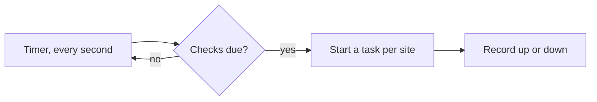

This tutorial designs a small project from an empty folder to a generated
design document, in about twenty minutes. Every step uses a real command,
and every output shown is what Kiln printed for this example. Read it
once end to end before designing your own project. [Designing a project
with Kiln](Designing-with-Kiln) then explains how to scale the same steps
up.

The example project is **Beacon**, a small program that checks whether
websites respond and reports the ones that don't. You don't need to know
anything about Beacon; it is only something to design.

## Before you start

- Kiln on your `PATH` ([Installing](Installing)). `kiln --version` should
  print a version.
- `git`. Kiln works without it, but most projects live in a repository.
  Later steps (code links, baselines) use it.
- A text editor. Any will do. Fenix and editors with Kiln's language
  server add completion and navigation ([Editors and
  Flint](Editors-and-Flint)), but nothing here needs them.

## 1. Start the project

```console
$ mkdir beacon && cd beacon
$ git init
$ kiln init --name Beacon
kiln.toml
design/
kiln: started project "Beacon"; `kiln new requirement --title "…"` adds the first item
```

`kiln init` writes two things:

- **`kiln.toml`**, the project's configuration. It declares seven item
  **types**, the **link roles** between them, and nothing else yet.
- **`design/`**, the folder your items will live in, with a short
  `README.md`.

The default types are a good starting point for most projects:

| Type | ID prefix | Statuses | Use it for |
|---|---|---|---|
| `requirement` | `REQ` | draft, proposed, approved, implemented, verified, obsolete | what the project must do or be |
| `design` | `DES` | draft, accepted, obsolete | how a part of it works |
| `decision` | `ADR` | proposed, accepted, rejected, superseded | a choice and why it was made |
| `milestone` | `MS` | planned, active, done, dropped | a deliverable step |
| `task` | `TASK` | todo, doing, blocked, done, dropped | a piece of work |
| `test` | `TEST` | draft, ready, passing, failing, obsolete | a test you plan or run by hand |
| `risk` | `RISK` | open, mitigated, accepted, closed | something that could go wrong |

You can rename, remove or add types later ([Configuration](Configuration)).

## 2. Write the first requirements

`kiln new` creates an item with the next free ID and prints where it put
it:

```console
$ kiln new requirement --title "Beacon checks every configured site on a schedule"
design/requirements/REQ-001-beacon-checks-every-configured-site-on-a-schedule.md
$ kiln new requirement --title "A check finishes within 5 seconds per site" --parent REQ-001
design/requirements/REQ-002-a-check-finishes-within-5-seconds-per-site.md
$ kiln new requirement --title "Failures are reported within one minute"
design/requirements/REQ-003-failures-are-reported-within-one-minute.md
```

Each item is an ordinary Markdown file. It starts with a **front matter**
block in TOML between two `+++` lines. Here is REQ-002 as `kiln new`
wrote it:

```markdown
+++
id = "REQ-002"
type = "requirement"
title = "A check finishes within 5 seconds per site"
status = "draft"
parent = "REQ-001"
+++
```

`parent` makes REQ-002 a child of REQ-001. Use it to break a broad
requirement into precise ones.

Open REQ-001 and write what it means, below the front matter. Add a tag,
too. Tags are free-form words you can later use to group items in the
document:

```markdown
+++
id = "REQ-001"
type = "requirement"
title = "Beacon checks every configured site on a schedule"
status = "draft"
tags = ["core"]
+++

Beacon reads a list of sites from `beacon.toml` and sends each one an
HTTP request every `interval` seconds (default 60). A site is **up** when
it answers with a status below 400 within its timeout.
```

The body is plain Markdown: anything GitHub or GitLab renders, plus a few
additions covered later (references, diagrams, callouts).

Check the project:

```console
$ kiln check
kiln: no findings
```

## 3. Approve requirements and see what's missing

A requirement in `draft` is a proposal. Once the team agrees on it, mark
it `approved`. `kiln set` changes front matter without touching anything
else in the file:

```console
$ kiln set REQ-001 status=approved
REQ-001: status draft → approved
$ kiln set REQ-002 status=approved
REQ-002: status draft → approved
$ kiln check
design/requirements/REQ-001-beacon-checks-every-configured-site-on-a-schedule.md:2:7: K201 warning: REQ-001 is approved but nothing verifies it
design/requirements/REQ-001-beacon-checks-every-configured-site-on-a-schedule.md:2:7: K202 warning: REQ-001 is approved but nothing implements it
design/requirements/REQ-002-a-check-finishes-within-5-seconds-per-site.md:2:7: K201 warning: REQ-002 is approved but nothing verifies it
design/requirements/REQ-002-a-check-finishes-within-5-seconds-per-site.md:2:7: K202 warning: REQ-002 is approved but nothing implements it
kiln: 4 warnings
```

This is the heart of Kiln. An approved requirement should eventually be
**implemented** (by a design, a task or code) and **verified** (by a test
or test code). Kiln calls this **coverage**, and it warns about every gap.
Drafts are left alone (REQ-003 has no warning) because nobody has agreed
to them yet.

Warnings don't fail `kiln check` (the exit code is still 0). Errors do.
You can promote these warnings to errors once your design settles
([Checking](Checking)).

## 4. Answer the requirements

Create the items that answer REQ-001 and REQ-002:

```console
$ kiln new decision --title "Checks run concurrently, one task per site"
design/decisions/ADR-001-checks-run-concurrently-one-task-per-site.md
$ kiln new design --title "The scheduler"
design/designs/DES-001-the-scheduler.md
$ kiln new test --title "A slow site is cut off at its timeout"
design/tests/TEST-001-a-slow-site-is-cut-off-at-its-timeout.md
$ kiln new milestone --title "First release"
design/milestones/MS-001-first-release.md
$ kiln new task --title "Write the scheduler"
design/tasks/TASK-001-write-the-scheduler.md
$ kiln new risk --title "Many sites exhaust file descriptors"
design/risks/RISK-001-many-sites-exhaust-file-descriptors.md
```

Now **link** them. A link has a **role** (`implements`, `verifies`,
`part-of`, `mitigates`…) and is always written on its source side. The
design says it implements the requirement; the requirement never lists
what implements it. Kiln computes the reverse direction ("implemented
by") for you.

```console
$ kiln link DES-001 implements REQ-001
DES-001 implements REQ-001
$ kiln link TEST-001 verifies REQ-002
TEST-001 verifies REQ-002
$ kiln link TASK-001 part-of MS-001
TASK-001 part-of MS-001
$ kiln link TASK-001 implements REQ-002
TASK-001 implements REQ-002
$ kiln link DES-001 mitigates RISK-001
DES-001 mitigates RISK-001
```

`kiln link` writes a `[links]` table into the source item's front matter.
You can just as well type it yourself. DES-001 now starts like this:

```markdown
+++
id = "DES-001"
type = "design"
title = "The scheduler"
status = "draft"

[links]
implements = ["REQ-001"]
mitigates = ["RISK-001"]
+++
```

Kiln refuses links that `kiln.toml` doesn't allow, and says what would be
allowed:

```console
$ kiln link REQ-001 verifies TEST-001
kiln: a requirement can't be the source of `verifies` (from: test, code)
```

### Write the decision

A **decision** records a choice, its context and its consequences, so
nobody has to re-argue it a year later. Fill in ADR-001 and accept it:

```markdown
+++
id = "ADR-001"
type = "decision"
title = "Checks run concurrently, one task per site"
status = "accepted"
+++

## Context

REQ-002 gives each check 5 seconds. Checked one after another, 20 slow
sites would take 100 seconds and miss the one-minute schedule of
[[REQ-001]].

## Decision

Each site gets its own asynchronous task; at most 64 run at once.

## Consequences

A slow site never delays another. The limit of 64 keeps file descriptors
in check (RISK-001).
```

`[[REQ-001]]` is a **reference**. In exports it becomes a link showing the
item's ID and title. A bare ID such as `REQ-002` or `RISK-001` in prose is
a reference too, as long as its prefix is one your project declares. A
reference is a **mention**, not a link: it shows up under "mentioned by",
but it doesn't count toward coverage. Only `[links]` and code references
do.

### Draw a diagram

Give DES-001 a body with a Mermaid diagram. Kiln checks the diagram
parses, and draws it in HTML, Word and Confluence exports:

````markdown
A single timer wakes every second and starts the checks that are due,
up to the limit set by ADR-001.


````

Set its status to `accepted` (`kiln set DES-001 status=accepted`).

## 5. Link the code

Requirements are also answered by code. Tell Kiln where your source is by
uncommenting the `[code]` section of `kiln.toml`:

```toml
[code]
paths = ["src"]
```

Then mark the code with a comment naming the role and the IDs:

```rust
// implements: REQ-001
pub fn run_due_checks() {}

#[test]
// verifies: REQ-001, REQ-003
fn every_site_is_checked_once_per_interval() {}
```

The comment style doesn't matter: `#`, `--` and `;` work too. Kiln matches
the text `implements:` or `verifies:` followed by IDs on any line, in any
language. The file and line become the source of a link.

```console
$ kiln check
kiln: no findings
```

All warnings are gone:

- REQ-001 is implemented by DES-001 and the code, and verified by the
  test code.
- REQ-002 is implemented by TASK-001 and verified by TEST-001.

## 6. Look around

`kiln list` shows every item:

```console
$ kiln list
REQ-001   approved  Beacon checks every configured site on a schedule
REQ-002   approved  A check finishes within 5 seconds per site
REQ-003   draft     Failures are reported within one minute
DES-001   accepted  The scheduler
ADR-001   accepted  Checks run concurrently, one task per site
MS-001    planned   First release
TASK-001  todo      Write the scheduler
TEST-001  draft     A slow site is cut off at its timeout
RISK-001  open      Many sites exhaust file descriptors
```

`kiln show` shows one item with everything connected to it, in both
directions:

```console
$ kiln show REQ-001
REQ-001 Beacon checks every configured site on a schedule
requirement · approved · design/requirements/REQ-001-beacon-checks-every-configured-site-on-a-schedule.md:2
children        REQ-002 A check finishes within 5 seconds per site
tags            core
implemented by  DES-001 The scheduler, src/scheduler.rs:1
verified by     src/scheduler.rs:5
mentioned by    ADR-001 Checks run concurrently, one task per site
coverage        implements: yes, verifies: yes
```

`kiln trace` is the traceability matrix. It lists every requirement with
what covers it, and the gaps:

```console
$ kiln trace
Requirements coverage

REQ-001  Beacon checks every configured site on a schedule  (approved)
         implemented by: DES-001, src/scheduler.rs:1
         verified by: src/scheduler.rs:5

REQ-002  A check finishes within 5 seconds per site  (approved)
         implemented by: TASK-001
         verified by: TEST-001

REQ-003  Failures are reported within one minute  (draft)
         implemented by: — gap
         verified by: src/scheduler.rs:5

3 requirements; covered: implements 2/3, verifies 3/3
```

`kiln impact` answers "if this changes, what else is affected?":

```console
$ kiln impact REQ-002
TASK-001  implements REQ-002 — TASK-001 Write the scheduler
TEST-001  verifies REQ-002 — TEST-001 A slow site is cut off at its timeout
```

`kiln` on its own opens a window with the same views: a tree, the trace,
impact, a board of tasks, the roadmap, the decision log and changes since
a release ([The GUI](The-GUI)).

## 7. Make a mistake on purpose

Change `RISK-001` in ADR-001's body to `RISK-010`, which doesn't exist:

```console
$ kiln check
design/decisions/ADR-001-checks-run-concurrently-one-task-per-site.md:21:11: K102 error: reference RISK-010 doesn't exist
kiln: 1 error
$ echo $?
1
```

Every finding names the file, line and column, a rule code and the
problem. Errors make `kiln check` exit with 1, which is what fails a CI
job. [Checking](Checking) lists every rule and how to fix it. Put
`RISK-001` back.

## 8. Generate the design document

A **template** gives the document its shape: your own headings and prose,
with **directives** (HTML comments) where Kiln places items and reports.
(`kiln preset add design-doc` writes a ready-made one and its export for
you; arc42 and a requirements specification are [presets](Presets) too.
Here you write one, to see how it works.) Create
`design/templates/design-document.md`:

```markdown
# Introduction

<!-- kiln:summary -->

Beacon checks that websites respond and reports the ones that don't.
This document is generated from the files in `design/`; edit those.

<!-- kiln:toc -->

# Requirements

<!-- kiln:items type="requirement" -->

# Design

<!-- kiln:items type="design" -->

# Decisions

<!-- kiln:items type="decision" -->

# Plan

<!-- kiln:report roadmap -->

# Risks

<!-- kiln:report risks -->

# Appendix: traceability

<!-- kiln:report traceability -->
```

Declare two **export targets** at the end of `kiln.toml`: a Markdown file
to commit, and a self-contained HTML file to send to people:

```toml
[[export]]
name = "design-md"
format = "markdown"
title = "Beacon — design document"
template = "design/templates/design-document.md"
path = "docs/DESIGN.md"
[export.markdown]
flavour = "github"

[[export]]
name = "design-html"
format = "html"
title = "Beacon — design document"
template = "design/templates/design-document.md"
path = "out/design.html"
```

Try a dry run first. It writes nothing and lists open items the template
didn't place:

```console
$ kiln export --dry-run
design-md (markdown, document) → docs/DESIGN.md
  would create docs/DESIGN.md
  leaves out: TASK-001, TEST-001
design-html (html, document) → out/design.html
  would create out/design.html
  leaves out: TASK-001, TEST-001
```

Leaving tasks and tests out of a design document is a fine choice. "leaves
out" makes sure it is a choice and not an accident. To include them, add
a section with `<!-- kiln:items type="task" style="row" -->`, which shows
them as one compact table.

```console
$ kiln export
design-md (markdown, document) → docs/DESIGN.md
  create docs/DESIGN.md
  leaves out: TASK-001, TEST-001
design-html (html, document) → out/design.html
  create out/design.html
  leaves out: TASK-001, TEST-001
```

The start of `docs/DESIGN.md`:

```markdown
# Beacon — design document

## 1 Introduction

Generated by Kiln from the files in this repository.

| Type | Items | By status |
| --- | ---: | --- |
| Requirements | 3 | draft 1, approved 2 |
| Designs | 1 | accepted 1 |
…

Requirements: implemented by 2 of 3, verified by 3 of 3.

- [MS-001 First release](#5-plan): 0 of 1 done

Beacon checks that websites respond and reports the ones that don't. …

## 2 Requirements

### 2.1 REQ-001 Beacon checks every configured site on a schedule

**approved** · implemented by [DES-001 The scheduler](#31-des-001-the-scheduler), [src/scheduler.rs:1](../src/scheduler.rs#L1) · verified by [src/scheduler.rs:5](../src/scheduler.rs#L5)

Beacon reads a list of sites from `beacon.toml` and sends each one …

#### 2.1.1 REQ-002 A check finishes within 5 seconds per site
…
```

Each item becomes a numbered heading with its status and links on one
line, followed by its body. References are links, and code locations link
to the file and line. Open `out/design.html` in a browser; "Print to PDF"
gives a printable PDF. The same template also exports to Word and to a
Confluence page ([Templates and exports](Templates-and-exports),
[Publishing to Confluence](Publishing-to-Confluence)).

## 9. Keep it honest

Commit everything except `out/`:

```console
$ echo out/ >> .gitignore
$ git add -A && git commit -m "Design: Beacon's first requirements"
```

From now on:

- Run `kiln check` in CI, so a broken reference, a duplicate ID or (once
  you make K201 an error) an unverified approved requirement fails the
  merge request.
- Run `kiln export --check` in CI. It fails when the committed
  `docs/DESIGN.md` is out of date, so the document can never drift from
  the items.
- Tag releases (`git tag v1.0`). Later, `kiln diff v1.0` and `kiln export
  --since v1.0` show reviewers exactly what changed in the design
  ([Changes and baselines](Changes-and-baselines)).

[Continuous integration](Continuous-integration) has ready-made workflows
for GitHub Actions and GitLab.

## What you did

| You wanted | You used |
|---|---|
| a project | `kiln init` |
| an item | `kiln new TYPE --title …`, then wrote its body |
| to change a status | `kiln set ID status=…` |
| to connect items | `kiln link SOURCE ROLE TARGET`, or `[links]` in front matter |
| to connect code | `[code] paths` plus `implements:` / `verifies:` comments |
| to see the gaps | `kiln check`, `kiln trace` |
| to see connections | `kiln show`, `kiln impact`, `kiln` (the window) |
| a document | a template, `[[export]]`, `kiln export` |

See also: [Designing a project with Kiln](Designing-with-Kiln) ·
[Concepts](Concepts) · [Item files](Item-files) · [Templates and
exports](Templates-and-exports)
